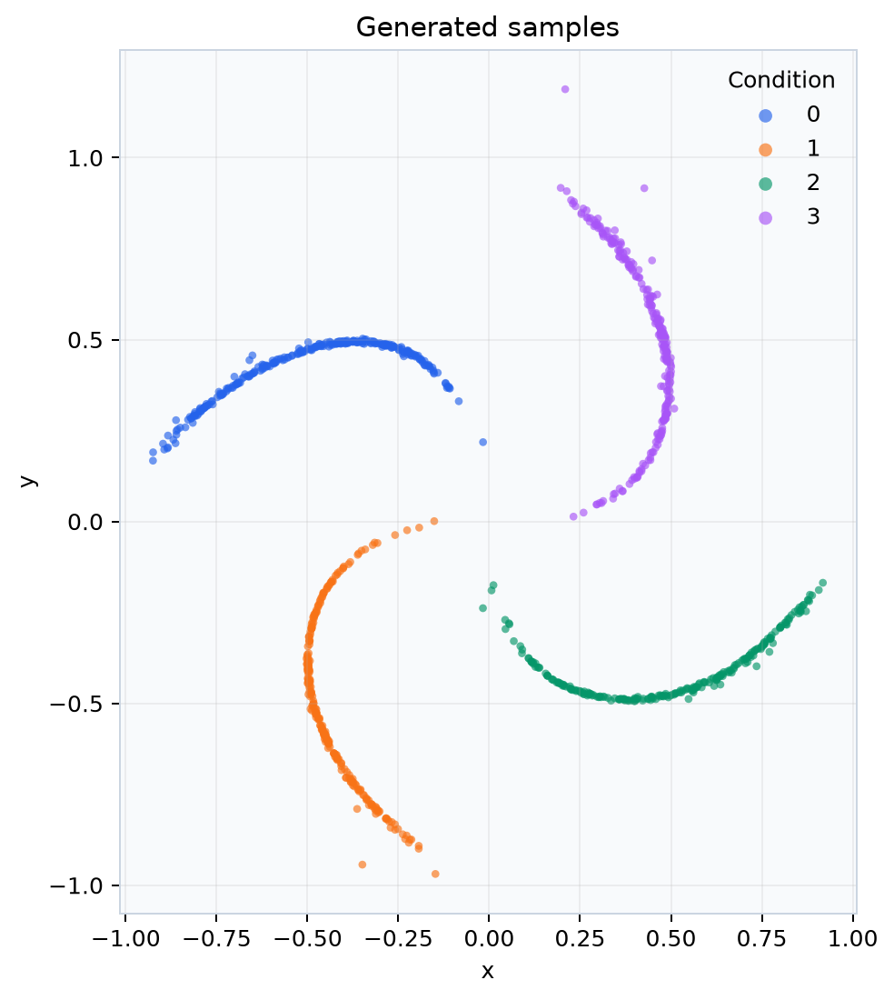
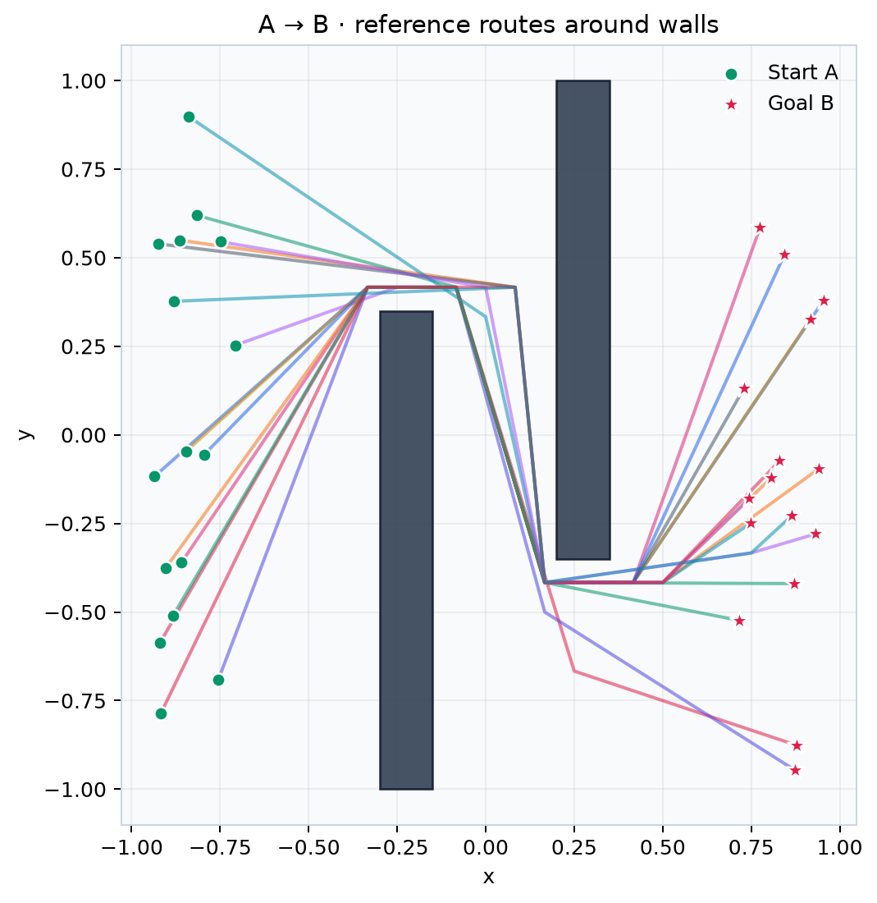

# Diffusion Lab

Исследовательский проект из `diffusion_modeling_1.ipynb`: генерация точек и траекторий,
условные DDPM/DDIM и rectified flow, диагностика векторных полей. **Основной пример —
вращающиеся лучи**, как в активном запуске исходного ноутбука.

Модель наследует `diffusers.ModelMixin` / `ConfigMixin`, пайплайн —
`DiffusionPipeline`. Зашумление и обратные переходы используют настоящие
[`DDPMScheduler`](https://huggingface.co/docs/diffusers/api/schedulers/ddpm),
[`DDIMScheduler`](https://huggingface.co/docs/diffusers/api/schedulers/ddim) и
[`FlowMatchEulerDiscreteScheduler`](https://huggingface.co/docs/diffusers/api/schedulers/flow_match_euler_discrete).
Модель и scheduler сохраняются через `save_pretrained`; веса — Safetensors.

## Открыть и попробовать

[Обученная модель в Colab](https://colab.research.google.com/github/Vovanm88/ddpm_vibe_research/blob/main/notebooks/06_trained_interactive_demo.ipynb)
· [PyTorch quickstart в Colab](https://colab.research.google.com/github/Vovanm88/ddpm_vibe_research/blob/main/notebooks/03_standalone_quickstart.ipynb)
· [Изменение компонентов в Colab](https://colab.research.google.com/github/Vovanm88/ddpm_vibe_research/blob/main/notebooks/04_change_components.ipynb)

Установка из пустого Jupyter:

```python
%pip install "diffusion-lab[interactive] @ git+https://github.com/Vovanm88/ddpm_vibe_research.git"
```

В [обученном notebook](notebooks/06_trained_interactive_demo.ipynb) пакет устанавливается
из GitHub, веса и контрольная выборка загружаются из отдельных файлов `demo/`.
Можно сразу менять condition/timestep/CFG,
тип поля и потенциальную проекцию, генерировать точки и проигрывать денойзинг.
Результат нового запуска — в [demo/](demo/README.md): **120 эпох, SWD 0.658 → 0.057**
на отдельной выборке. Есть PNG/SVG, GIF, интерактивный HTML и checkpoint.

## Новый Jupyter / Colab

Откройте [03_standalone_quickstart.ipynb](notebooks/03_standalone_quickstart.ipynb)
или [04_change_components.ipynb](notebooks/04_change_components.ipynb). Первая ячейка
устанавливает пакет из GitHub в текущий kernel. Нужны Python 3.11+, Git и интернет;
локальная папка проекта не требуется. Подробности —
[docs/notebook_quickstart.md](docs/notebook_quickstart.md).

Главный интерфейс — обычные PyTorch / Diffusers компоненты:

```python
from diffusers import DDIMScheduler
from torch.utils.data import DataLoader
import torch
from diffusion_lab import PointDenoiser, ResearchDiffusionPipeline
from diffusion_lab.environments import make_environment

dataset = make_environment("rotating_rays", n_samples=1024, n_classes=4, seed=42)
model = PointDenoiser(sample_shape=dataset.sample_shape, num_classes=dataset.num_classes,
                     hidden_dim=64, conditioner="embedding")
scheduler = DDIMScheduler(num_train_timesteps=100, beta_schedule="squaredcos_cap_v2",
                          prediction_type="v_prediction", clip_sample=False,
                          timestep_spacing="trailing")
pipeline = ResearchDiffusionPipeline(model, scheduler)
loader = DataLoader(dataset, batch_size=128, shuffle=True)
optimizer = torch.optim.AdamW(model.parameters(), lr=1e-3)
```

В ноутбуке дальше показан весь `forward → loss → backward → optimizer.step`,
генерация через `pipeline(...)`, поля и сохранение/продолжение обучения.
Можно свободно заменить `model`, `loss_fn`, `optimizer`, условия и тело шага.
В `04` каждый вариант действительно обучается: MLP/Transformer/своя модель,
MSE/Huber/свой loss, one-hot/embedding/Fourier conditioner, AdamW/Adam,
epsilon/v prediction, rectified flow и среды разных размерностей.

Для совсем пустого notebook используйте установку из GitHub выше или скопируйте
первую установочную ячейку из самостоятельного notebook.
Обычный `DiffusionTrainer` и краткий `create_experiment` доступны как дополнительные
утилиты; ручной training loop использует непосредственно torch-модель и scheduler.

Ноутбуки содержат только код и описания. После изменения пакета обновите его
в GitHub и повторите установочную ячейку; если пакет уже импортирован,
перезапустите kernel. Для разработки из локального checkout используйте
`pip install -e '.[dev,interactive]'`.

## Быстрый старт

Нужен Python 3.11+ и [uv](https://docs.astral.sh/uv/). В созданной локальной папке
`.venv` уже установлены зависимости и выполнены проверки.

```bash
cd /Users/vvmelnikov/Documents/thub_eda/diffusion-lab
uv sync --locked --extra dev --extra interactive

# Проверка всего пути: данные → обучение → checkpoint → графики → метрики.
# Три эпохи проверяют работоспособность; для качества нужен более долгий запуск.
uv run diffusion-lab train --config configs/smoke.yaml --output outputs/my_smoke

# Основной исследовательский рецепт, 4 вращающихся луча.
uv run diffusion-lab train --config configs/rays.yaml --output outputs/my_rays

# Возобновить: epochs — суммарное число эпох, включая уже выполненные.
uv run diffusion-lab train --config configs/rays.yaml --output outputs/my_rays \
  --epochs 300 --resume outputs/my_rays/checkpoint.pt

# Условная генерация класса 2, другой scheduler и GIF процесса.
uv run diffusion-lab sample outputs/my_rays/pipeline --condition 2 \
  --scheduler ddim --steps 100 --num-samples 256 --gif --output outputs/class_2

# Перестроить отчёт без переобучения.
uv run diffusion-lab report outputs/my_rays --steps 100 --gif
```

Для запуска через обычный pip: `python3.11 -m venv .venv`, активировать среду,
затем `pip install -e '.[dev,interactive]'`. `uv.lock` фиксирует разрешённые версии.

## Что менять

| Исследование | Настройка / компонент |
|---|---|
| 1D / 2D / 3D точки | `environment.name`; размерность выводится из данных |
| Путь A→B длины L в D измерениях | `navigation_2d` / `navigation_3d`, `path_length` |
| One-hot → learned embedding | `model.conditioner: one_hot` / `embedding` |
| Непрерывный контекст | `model.conditioner: mlp`, вход `[start, goal, walls]` |
| MLP → внимание по позициям пути | `model.backbone: mlp` / `transformer` |
| ε / x₀ / v prediction | `scheduler.prediction_type: epsilon` / `sample` / `v_prediction` |
| DDPM / DDIM при генерации | `sampling.scheduler` или `sample --scheduler` |
| Rectified flow | `scheduler.kind: flow` + `training.objective: rectified_flow` |
| MSE / Huber / Min-SNR | `training.loss`; `training.snr_gamma` для diffusion |
| Дополнительная геометрия | `training.regularizers: endpoint, collision, smoothness, bounds` |
| Собственный компонент | `register_conditioner`, `register_loss`, `register_regularizer`, `register_objective` |

`sample_shape=(D,)` означает точки `[B,D]`; `(L,D)` — траектории `[B,L,D]`.
`hidden_dim` — ширина сети, а не размерность пространства. Все слои создаются до
оптимизатора. Transformer работает внутри каждой траектории; разные элементы
батча не обмениваются информацией. `None` и случайный dropout условий используют
отдельный обучаемый null-вектор; идентификатора «неизвестного класса» вне диапазона нет.

В `configs/` лежат рецепты `rays`, `rays_flow`, `gaussian_1d`, `moons`, `helix_3d`,
`navigation_2d`, `navigation_3d` и быстрый `smoke`. Базовый рецепт лучей использует
`v_prediction` и cosine schedule; `epsilon` тоже поддерживается и проверяется.
Эти настройки — стартовые исследовательские рецепты, без утверждения оптимальности.

Другие доступные среды: `rings`, `spirals`, `blobs_3d`, `navigation_1d`.
`n_samples` всегда означает общее число примеров, а не число на класс.

## Обход стен

```bash
uv run diffusion-lab train --config configs/navigation_2d.yaml --output outputs/walls
uv run diffusion-lab sample outputs/walls/pipeline --steps 100 \
  --num-samples 32 --output outputs/new_routes
uv run python examples/navigation_research.py --dim 3 --epochs 3 --output outputs/nav3_tutorial
```

Навигационная среда строит эталонные маршруты через A* и проверяет пересечения
**всех сегментов** со стенами, включая промежутки между waypoint. Ресемплинг
сохраняет углы маршрута. Условия содержат A, B и low/high-углы стен; можно задавать
свою сцену через `environment.walls` и `environment.bounds` в YAML.

При генерации A/B фиксируются через inpainting на соответствующем уровне шума.
Для свободных концов есть `--free-endpoints`. Новые условия можно передать как
JSON-вектор в `--condition` или массив `[B,K]` через `--conditions-file`.

Collision loss помогает обучению, но допустимость оценивается отдельной точной
геометрической проверкой. В отчёте сохраняются доля допустимых маршрутов,
ошибка концов, длина и гладкость. Короткий учебный запуск может выдавать маршруты,
пересекающие стены; качество необходимо измерять после обучения. В 1D сплошную
стенку обойти невозможно: среда отклоняет пары A/B из разных компонент.

## Визуализации и поля

Отчёт содержит PNG и **SVG**, KDE с реальными координатами, стрелки с цветом
исходной величины, streamlines в 2D, 3D-проекции/срезы, историю обучения,
численные метрики, `fields.html` со слайдером уровней шума и опциональный GIF.
Plotly HTML работает без внешнего CDN; GIF сохраняется через Pillow.

Пайплайн разделяет `epsilon`, `score = −ε/√(1−ᾱₜ)` и `denoising = x̂₀−xₜ`.
При запросе поля дополнительный шум не добавляется. У flow доступна скорость
`dx/dσ`, а направление денойзинга равно её отрицанию.

Потенциал восстанавливается в конвенции `F = −∇U`: в 1D интегрированием,
в 2D/3D через разреженную задачу наименьших квадратов. Возвращаются curl,
относительная ошибка восстановления и диагностика консервативности; препятствия
можно маскировать, каждую компоненту области отдельно привязать к нулю.
Неконсервативное поле даёт проекцию, а не точную энергию. Восстановленный потенциал
сам по себе не является нормированной плотностью. Подробности —
[docs/visualization.md](docs/visualization.md).

```bash
uv run python examples/field_gallery.py --output outputs/gallery
```

## Ноутбуки и расширение

`notebooks/01_rays_research.ipynb` и `02_navigation.ipynb` — небольшие клиенты
пакета с изменяемыми конфигами. Исходник сохранён без тяжёлых outputs/widgets в
`original_diffusion_modeling_1.ipynb`; ошибки и соответствия —
[docs/notebook_audit.md](docs/notebook_audit.md).

```bash
uv run --with jupyterlab --extra dev --extra interactive jupyter lab notebooks
uv run diffusion-lab sweep --config configs/rays.yaml --epochs 30 \
  --parameter model.conditioner --values one_hot embedding --output outputs/conditioner_sweep
```

Sweep сохраняет отдельные модели и `comparison.csv` / JSON при одинаковом seed.
Для серьёзного сравнения повторите опыт с несколькими seed и отдельной выборкой:
текущий отчёт сравнивает с синтетическим обучающим распределением.

Пример собственного loss/conditioner и контракт нового метода:
[docs/extending.md](docs/extending.md), [examples/custom_components.py](examples/custom_components.py).
Для зарегистрированных Python-компонентов импортируйте модуль регистрации перед
построением или загрузкой модели.

## Структура и воспроизводимость

```text
src/diffusion_lab/
  environments/   # генераторы, A*, геометрия, общий SampleDataset
  conditioning.py # сменные кодировщики и null-conditioning
  models.py       # Diffusers ModelMixin, MLP / Transformer
  schedulers.py   # scheduler factory и преобразования ε/x₀/v
  pipeline.py     # sampling, CFG, endpoint inpainting, поля
  objectives.py   # diffusion / rectified flow
  losses.py       # regression и геометрические regularizers
  training.py    # AdamW, EMA, RNG, checkpoint/resume
  visualization/ # grid, KDE, поля, потенциалы, HTML, GIF
  metrics.py     # sliced Wasserstein и геометрические метрики
  cli.py         # train / sample / report / sweep
configs/ notebooks/ examples/ tests/ docs/
```

Каждый запуск сохраняет конфиг, manifest с версиями/seed/ревизией Git,
SHA256 данных, историю, checkpoint с optimizer/EMA/RNG и экспортированный
пайплайн. Resume поддерживается на границе эпох; менять можно суммарное число
эпох. Изменение scheduler, модели, остальных настроек обучения или данных
отклоняется. Точное совпадение продолжения проверено на CPU; ускорители могут
иметь другую численную воспроизводимость. `device` принимает `cpu`, `cuda`,
`mps`, `auto`; по умолчанию используется CPU.

`outputs/` и `.venv/` исключены из Git. Выбранный обученный пример публикуется
в `demo/`. Remote: `git@github.com:Vovanm88/ddpm_vibe_research.git`.

```bash
uv run pytest -q
uv run ruff check src tests examples
```

Фактические проверки — [docs/validation.md](docs/validation.md).

Пример генерации после 80 эпох и проверенные эталонные маршруты:



