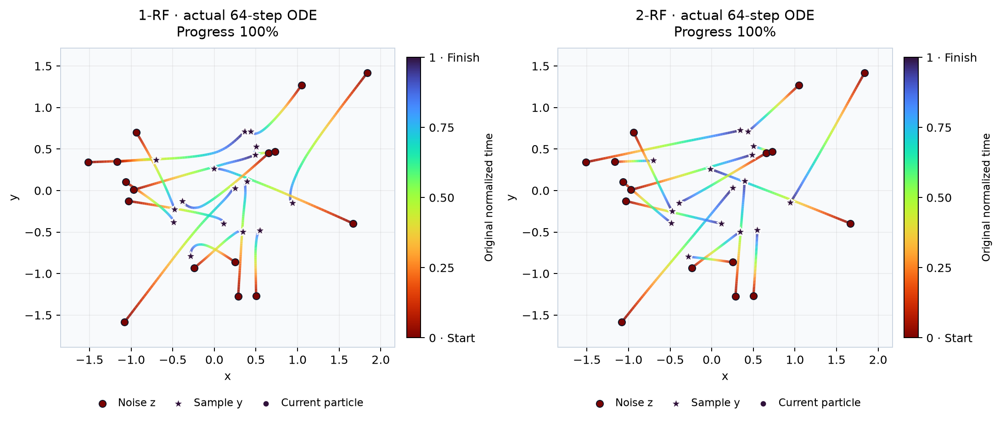

# Дистилляция и reflow прямо в Jupyter

Три самостоятельных ноутбука используют обычные `nn.Module`, `DataLoader`,
`torch.optim` и Diffusers schedulers. Target, loss, forward teacher/student,
`zero_grad`, `backward`, gradient clipping и `step` находятся в ячейках.
Алгоритмы не перенесены в trainer пакета: редактируйте и запускайте их на месте.

| Notebook / Colab | Что обучается |
|---|---|
| [07: progressive distillation](https://colab.research.google.com/github/Vovanm88/ddpm_vibe_research/blob/main/notebooks/07_progressive_distillation.ipynb) | Student воспроизводит два детерминированных DDIM-перехода teacher одним; 100 → 50 → 25 шагов |
| [08: model + guidance distillation](https://colab.research.google.com/github/Vovanm88/ddpm_vibe_research/blob/main/notebooks/08_model_and_guidance_distillation.ipynb) | Новая меньшая модель с нуля воспроизводит guided prediction teacher одним forward |
| [09: Rectified Flow + reflow](https://colab.research.google.com/github/Vovanm88/ddpm_vibe_research/blob/main/notebooks/09_rectified_flow_reflow.ipynb) | Обучение 1-RF, связанные пары noise/teacher-endpoint, обучение 2-RF; опционально 3-RF |

Скачайте один `.ipynb`, откройте в Python 3.11+ Jupyter и выполните сверху вниз.
Первая ячейка устанавливает исходники из GitHub. В 07/08 teacher загружается
из отдельных файлов `demo/pipeline`; вне checkout ноутбук клонирует репозиторий.
09 самостоятельно обучает исходный RF teacher. Wheel, веса и outputs в ноутбуки
не встроены. Для фиксации версии укажите commit SHA в установочной ячейке.
После обновления уже импортированного пакета перезапустите kernel.

## 07: сокращение числа шагов

Реализован two-to-one target из
[Progressive Distillation, Salimans & Ho](https://arxiv.org/abs/2202.00512).
Teacher делает `t → s → r`, затем код инвертирует один DDIM-переход `t → r`
и получает target для v-prediction student. Терминальное `r=-1` означает
чистый sample с alpha=1, sigma=0; отрицательная индексация массива не используется.
Teacher заморожен, одинаковый condition mask действует на оба его перехода и student.
EMA student становится teacher следующей стадии.

Здесь `num_train_timesteps=1000`, trailing grid, `eta=0`, без clipping.
Числа шагов должны делить 1000, а соседние сетки — быть вложенными через каждый
второй timestep: 100 → 50 → 25 проходит проверку; 64 → 32 отклоняется.
Это сохраняет соответствие явного sampler настоящему `DDIMScheduler.step`.
Сохранённый student используйте с его **обученной сеткой** 50 либо 25 шагов;
она записана в `distillation_config.json`. Общий pipeline сам не подставляет
этот бюджет из sidecar:

```python
pipeline = ResearchDiffusionPipeline.from_pretrained(
    "demo/research/progressive_distillation/stage_25/pipeline",
    local_files_only=True,
)
result = pipeline(batch_size=128, conditions=2, num_inference_steps=25,
                  guidance_scale=1.0)
```

По умолчанию 60 + 100 эпох. Checkpoint сохраняет live/EMA model, AdamW,
историю и RNG loader/noise/timestep/mask. Повторный запуск продолжает с checkpoint;
для другой архитектуры, loss или рецепта задайте новый `OUTPUT_DIR`.

## 08: другая архитектура и CFG одним forward

Student 96×2 инициализируется случайно; teacher 128×4 остаётся отдельным frozen
объектом. Target виден: `v_u + GUIDANCE * (v_c - v_u)` при сохранённом условии,
`v_u` при null mask. Loss — MSE по v плюс редактируемый MSE по teacher x0.
Второй term перевзвешивает ту же ошибку; он не является независимой разметкой.

Это фиксированный guidance-вариант output distillation, вдохновлённый
[On Distillation of Guided Diffusion Models](https://arxiv.org/abs/2210.03142).
В отличие от полного метода статьи, guidance здесь не дополнительный вход;
мы также меняем архитектуру и начинаем student с нуля. Число DDIM-шагов остаётся 100.
При deployment нужен **`guidance_scale=1`**: выбранный при обучении `GUIDANCE=1.5`
уже включён в условные ответы student. Для другого встроенного scale student
нужно обучить заново; Unconditional использует отдельно обученную null-ветку.

Параметры модели, loss weights, optimizer и 150-epoch loop редактируются в ячейках.
Есть интерактивные поля и генерация, parity по уровням шума, actual NFE,
отдельные unconditional метрики, Diffusers export и PyTorch training checkpoint.

## 09: связанные пары и reflow

Исходный 1-RF обучается на независимых data/noise по
[Rectified Flow](https://arxiv.org/abs/2209.03003). В конвенции Diffusers sigma=1
означает noise, sigma=0 — data; bridge `(1-sigma)*data + sigma*noise`,
velocity target `noise-data`, Euler движется с отрицательным delta sigma.

Затем frozen teacher получает Gaussian `z` и выдаёт endpoint `T(z,c)`.
Целая строка `(z, endpoint, label, keep_mask)` сохраняется и перемешивается вместе.
2-RF учится на прямых bridges этих **связанных** концов с тем же mask.
Null endpoints получены teacher с null-условием. По умолчанию student — копия
1-RF; `WARM_START_REFLOW=False` создаёт новую модель. Optional 3-RF повторяет
процесс с frozen 2-RF teacher. Код coupling, обучения, Euler и resume виден.

Сравнения используют одинаковые latents и labels, 1/4/16/64 шага, новые реальные
данные. Straightening измеряется на **плотных 64-step ODE-траекториях**:
length/chord и velocity deviation. Один Euler-шаг всегда рисует прямую линию,
поэтому эта геометрия не используется как доказательство reflow.
GIF показывает actual ODE: красный старт → фиолетовый финиш, общие оси и endpoints.

## Фактические запуски

Все defaults целиком выполнены на CPU, четыре потока, PyTorch 2.14.1,
Diffusers 0.39.0, diffusion-lab 0.3.2. Каждая оценка использует 1024 samples
и независимый reference из 4096 точек. SWD ниже — лучше; NFE — число forward.

| Опыт | Бюджет обучения | Результат |
|---|---|---|
| 07, guidance=1 | 60 + 100 эпох, обучение 33.1 с | Teacher 100: SWD 0.01333; student 25: 0.01334; NFE 100 → 25 |
| 08, guidance teacher=1.5 | 150 эпох, обучение 16.9 с | Untrained student: SWD 0.5442; teacher: 0.05442; student: 0.05500 |
| 08, размер / вычисления | Teacher 431362, student 131714 параметров | 3.27× меньше параметров, NFE 200 → 100; median 1.135 → 0.321 с на этой машине |
| 09 | 100 + 100 эпох; полный notebook 37.4 с | One-step SWD 0.1052 → 0.02276; dense length/chord 1.0758 → 1.0006 |

07: training seed 123, reference 2718, inference 1618; RMS евклидово расстояние
student-25 до teacher-100 на тех же latents — 0.00153. 08: seeds 801/802/803;
teacher/student SWD 0.00176. Guided parent не оптимален по data SWD: его
CFG-off вариант получает 0.01250; задача student — воспроизвести выбранный target.
09: seed 2026, разные seeded генераторы для train/coupling/eval;
one-step endpoint L2 до teacher меняется 0.2958 → 0.0390. Null one-step SWD
улучшается 0.3195 → 0.0536, а null 64-step SWD слегка ухудшается 0.0453 → 0.0503.

Это по одному запуску синтетических rotating rays, с разными settings между
ноутбуками: таблица не является сравнением методов на одинаковом бюджете.
Cloud Colab и GPU не проверены. Reflow наследует ошибки teacher; низкий training
loss сам по себе не гарантирует качество. Для исследования повторяйте seeds
и измеряйте одновременно data quality, teacher fidelity и стоимость генерации.

Полные отдельные artifacts, pipeline weights, optimizer checkpoints, метрики,
PNG/SVG, GIF и исходные paired данные опубликованы в
[demo/research](../demo/research/README.md). Локальные новые запуски пишут в
игнорируемый Git каталог `outputs/`.


