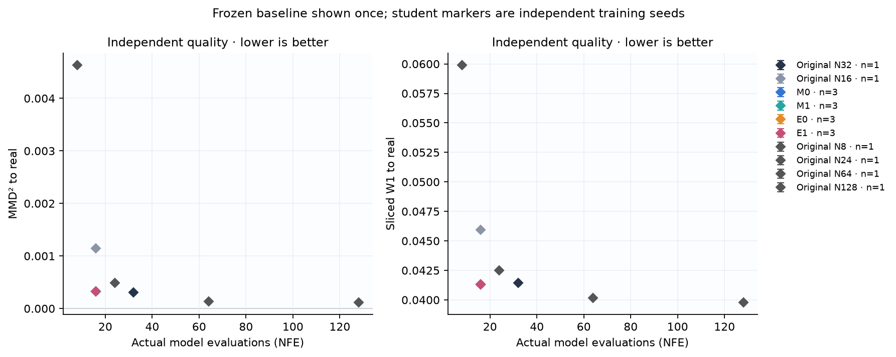
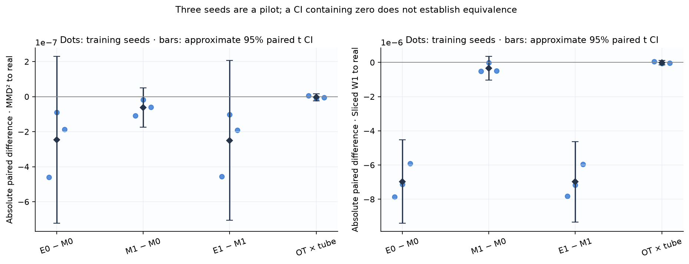
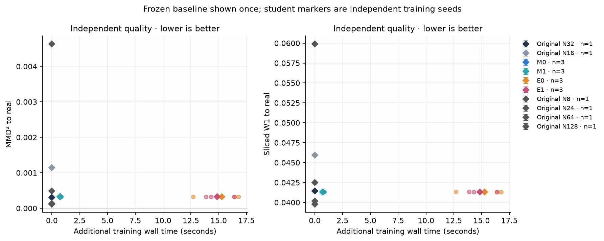
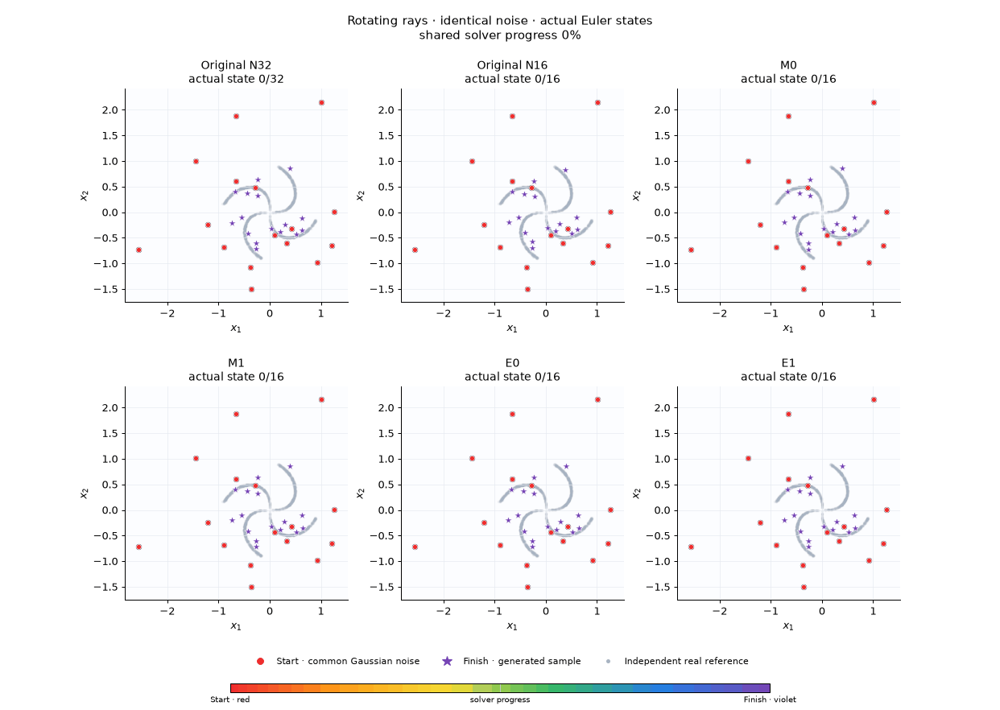
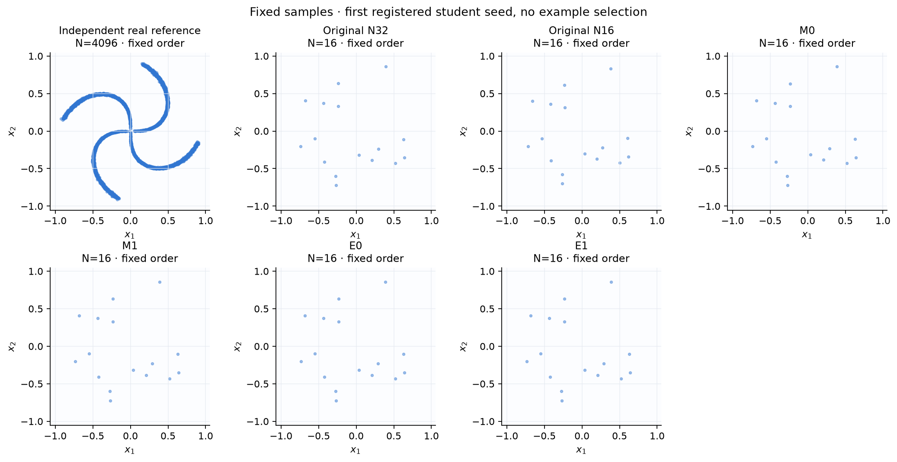
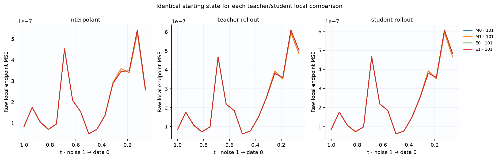
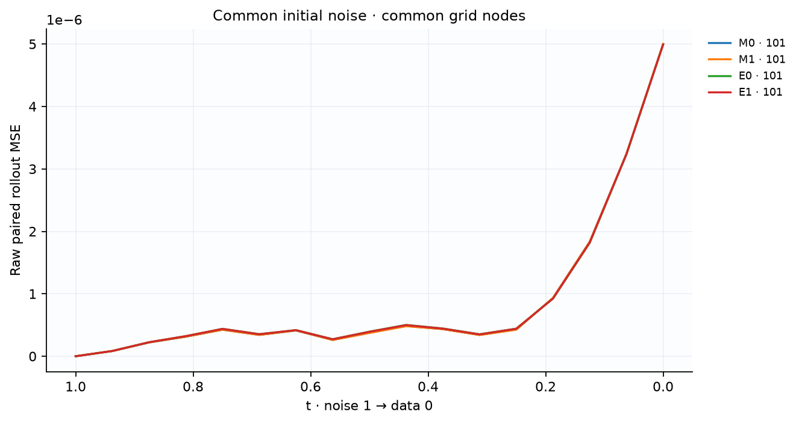
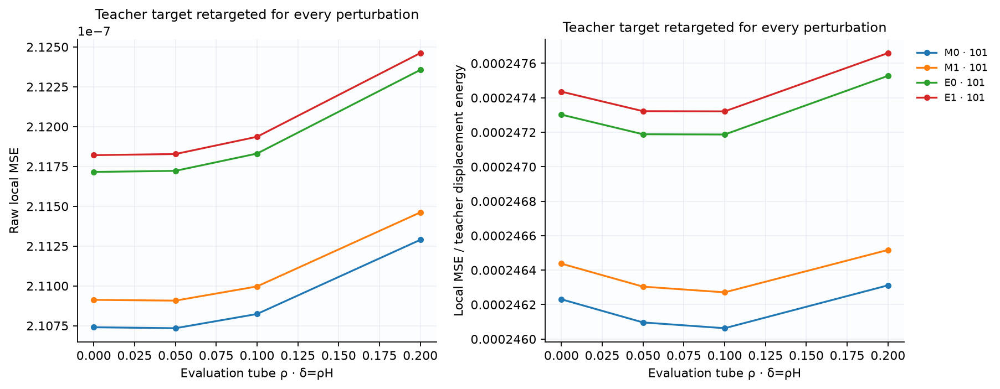
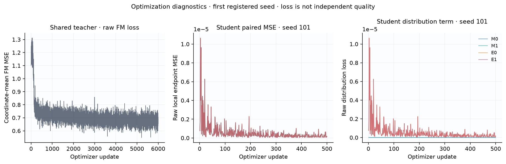

# Контролируемый пилот на вращающихся лучах

Это независимая реализация протокола [P] из REPLICATION_SPEC.md. Числа ниже получены на вращающихся лучах; это не результаты MNIST и не буквальное воспроизведение диплома.

**Основной MNIST-контраст E0 − M0: not_tested.** Полная MNIST-серия не выполнена на CPU. Результаты этого пилота проверяют реализацию и показывают поведение на малом стенде; они не устанавливают перенос на MNIST.

Зафиксированы один общий teacher и 3 student seed: `[101, 202, 303]`. Выбор анимаций: первый зарегистрированный seed `101`, без выбора по качеству. Все методы и NFE используют общий исходный шум; real reference независима от генераций.

Protocol: `rays_cpu_pilot_v1`. Teacher SHA: `5fcbe5ceee197bf2a257b1347586335d7feb8a15789ba406f918a077cf3e6930`. Noise SHA: `3e2400776365f34f754a5cb69b04c539be41b976ebb9df4f247f2be70d42ea09`.

## Качество относительно реальных данных

MMD² — несмещённая двухвыборочная оценка с фиксированным train-only RBF; отрицательные значения допустимы и сохранены. SWD здесь — среднее projected W1 существующего проекта, 1024 фиксированных независимых направления; это другая величина, чем squared SW2 training loss.

| Метод | Student seed | NFE | MMD² → real | SWD → real |
|---|---:|---:|---:|---:|
| Original N8 | frozen baseline | 8 | 0.00463536 | 0.0599121 |
| Original N16 | frozen baseline | 16 | 0.00114123 | 0.0459183 |
| Original N24 | frozen baseline | 24 | 0.000484651 | 0.0424931 |
| Original N32 | frozen baseline | 32 | 0.000305065 | 0.0414373 |
| Original N64 | frozen baseline | 64 | 0.000132119 | 0.0401516 |
| Original N128 | frozen baseline | 128 | 0.000113631 | 0.0397745 |
| M0 | 101 | 16 | 0.000329123 | 0.0413587 |
| M1 | 101 | 16 | 0.000329015 | 0.0413582 |
| E0 | 101 | 16 | 0.000328663 | 0.0413509 |
| E1 | 101 | 16 | 0.000328559 | 0.0413504 |
| M0 | 202 | 16 | 0.000323268 | 0.0413052 |
| M1 | 202 | 16 | 0.000323249 | 0.0413052 |
| E0 | 202 | 16 | 0.000323178 | 0.0412981 |
| E1 | 202 | 16 | 0.000323147 | 0.0412981 |
| M0 | 303 | 16 | 0.000325093 | 0.0413338 |
| M1 | 303 | 16 | 0.000325033 | 0.0413333 |
| E0 | 303 | 16 | 0.000324905 | 0.0413279 |
| E1 | 303 | 16 | 0.000324841 | 0.0413274 |

## Парные различия между независимыми обучениями

Отрицательное различие благоприятно для первого метода. Интервал — приближённый paired t CI по seed; три seed являются пилотом. Интервал, включающий ноль, не доказывает эквивалентность. Относительные проценты от MMD не вычисляются.

| Контраст | Метрика | Парные значения по seed | Mean | Sample std | 95% CI |
|---|---|---|---:|---:|---|
| E0_minus_M0 | mmd2_real | -4.6004e-07, -9.02038e-08, -1.87178e-07 | -2.45807e-07 | 1.91762e-07 | [-7.2217e-07, 2.30556e-07] |
| M1_minus_M0 | mmd2_real | -1.08285e-07, -1.87346e-08, -5.97639e-08 | -6.22612e-08 | 4.48275e-08 | [-1.73619e-07, 4.90965e-08] |
| E1_minus_M1 | mmd2_real | -4.55578e-07, -1.02476e-07, -1.91401e-07 | -2.49818e-07 | 1.83657e-07 | [-7.06046e-07, 2.0641e-07] |
| OT_x_tube_interaction | mmd2_real | 4.46152e-09, -1.22723e-08, -4.22336e-09 | -4.01138e-09 | 8.36892e-09 | [-2.48009e-08, 1.67782e-08] |
| E0_minus_M0 | sliced_wasserstein | -7.85801e-06, -7.11911e-06, -5.91669e-06 | -6.9646e-06 | 9.79839e-07 | [-9.39866e-06, -4.53055e-06] |
| M1_minus_M0 | sliced_wasserstein | -5.07631e-07, -1.4107e-08, -4.94447e-07 | -3.38728e-07 | 2.81208e-07 | [-1.03729e-06, 3.5983e-07] |
| E1_minus_M1 | sliced_wasserstein | -7.81608e-06, -7.17008e-06, -5.9508e-06 | -6.97899e-06 | 9.4721e-07 | [-9.33198e-06, -4.62599e-06] |
| OT_x_tube_interaction | sliced_wasserstein | 4.19359e-08, -5.09724e-08, -3.41039e-08 | -1.43801e-08 | 4.9495e-08 | [-1.37333e-07, 1.08572e-07] |

## Fidelity относительно общего teacher

Fidelity измеряет воспроизведение teacher при общем шуме; улучшение fidelity само по себе не означает улучшение качества относительно данных. Raw MSE считается без clamp.

| Метод | Student seed | NFE | Paired endpoint MSE |
|---|---:|---:|---:|
| Original N8 | frozen | 8 | 0.0021345 |
| Original N16 | frozen | 16 | 0.000259736 |
| Original N24 | frozen | 24 | 5.04367e-05 |
| Original N32 | frozen | 32 | 0 |
| Original N64 | frozen | 64 | 6.4201e-05 |
| Original N128 | frozen | 128 | 0.000139059 |
| M0 | 101 | 16 | 4.96514e-06 |
| M1 | 101 | 16 | 4.96568e-06 |
| E0 | 101 | 16 | 4.99049e-06 |
| E1 | 101 | 16 | 4.99033e-06 |
| M0 | 202 | 16 | 4.8812e-06 |
| M1 | 202 | 16 | 4.88612e-06 |
| E0 | 202 | 16 | 4.96113e-06 |
| E1 | 202 | 16 | 4.96524e-06 |
| M0 | 303 | 16 | 4.57696e-06 |
| M1 | 303 | 16 | 4.57373e-06 |
| E0 | 303 | 16 | 4.6427e-06 |
| E1 | 303 | 16 | 4.64e-06 |

## Стоимость

Время обучения teacher является общей стоимостью. В таблице training wall time ученика — дополнительная стоимость; frozen baseline не считается отдельным повторным обучением. Timings относятся к указанному batch и этому оборудованию. NFE — число последовательных evaluations для одного примера; total model calls дополнительно учитывает разбиение всего набора на batches.

| Метод | Seed | NFE / sample | Total model calls | Training seconds | Median generation seconds |
|---|---:|---:|---:|---:|---:|
| Original N8 | frozen | 8 | 64 | 13.1921 | 0.00152867 |
| Original N16 | frozen | 16 | 128 | 13.1921 | 0.00289458 |
| Original N24 | frozen | 24 | 192 | 13.1921 | 0.00593888 |
| Original N32 | frozen | 32 | 256 | 13.1921 | 0.0253584 |
| Original N64 | frozen | 64 | 512 | 13.1921 | 0.0543237 |
| Original N128 | frozen | 128 | 1024 | 13.1921 | 0.0385587 |
| M0 | 101 | 16 | 128 | 0.685726 | 0.0090415 |
| M1 | 101 | 16 | 128 | 0.681996 | 0.00322179 |
| E0 | 101 | 16 | 128 | 12.6966 | 0.00309992 |
| E1 | 101 | 16 | 128 | 13.8675 | 0.00328921 |
| M0 | 202 | 16 | 128 | 0.715683 | 0.00458771 |
| M1 | 202 | 16 | 128 | 0.688796 | 0.00595717 |
| E0 | 202 | 16 | 128 | 16.3743 | 0.00815079 |
| E1 | 202 | 16 | 128 | 16.4025 | 0.00578983 |
| M0 | 303 | 16 | 128 | 0.851825 | 0.00549137 |
| M1 | 303 | 16 | 128 | 0.743119 | 0.00348921 |
| E0 | 303 | 16 | 128 | 16.7658 | 0.00558246 |
| E1 | 303 | 16 | 128 | 14.3062 | 0.0042615 |

## Реальные траектории

Начало красное, конец фиолетовый. Кружки — общий Gaussian noise, звёзды — финальные точки. Кадры выбирают сохранённые состояния Euler; между узлами нет интерполяции. Все панели имеют одинаковые оси. Фиксированный первый seed не является выбором лучшего запуска.

## Диагностика и ограничения

Local error сравнивает teacher/student из одного и того же anchor. Рассматриваются interpolant, реальный teacher rollout и method-dependent student rollout. Для robustness teacher target пересчитывается после каждого возмущения; tube имеет δ=ρH на координату. Линейный интерполянт пары данных и шума не является индивидуальной ODE-траекторией маргинального поля.

Один teacher ограничивает выводы этим teacher. Три student seed недостаточны для универсального ранжирования. Ученики оцениваются на зарегистрированной сетке; frozen original на той же короткой сетке нужен для сравнения практической полезности. Снижение training loss, local error или совпадение с teacher не заменяет независимую оценку качества.

Основные H1–H4 для unconditional pixel MNIST остаются `not_tested`; сравнения лучей являются отдельным диагностическим пилотом. H3 (все пространства endpoint/displacement/joint) не проверяется матрицей MVP.

## Данные и воспроизведение отчёта

Таблицы автоматически построены из `evaluation/results.json`; парные различия сохранены в `paired_comparisons.csv`, отдельные строки — в `results_per_seed.csv`, происхождение кадров — в `animations_manifest.json`. Используются только сохранённые метрики и траектории; отчёт не обучает и не выбирает примеры.

Команда: `python -m recheck.cli report --runs replication/artifacts/rays_cpu_pilot_v1 --output <report_dir>/REPORT.md`.

## Кривые локальной ошибки, rollout и robustness

Student rollout anchors зависят от метода. Для каждого local сравнения вход у teacher/student общий; при каждом rho target пересчитывается. Производные, если измерены, следует читать вместе с проверкой при ζ/2.

## Наблюдаемая оптимизация

Loss служит диагностикой оптимизации; вывод о качестве основан на независимых quality metrics.
