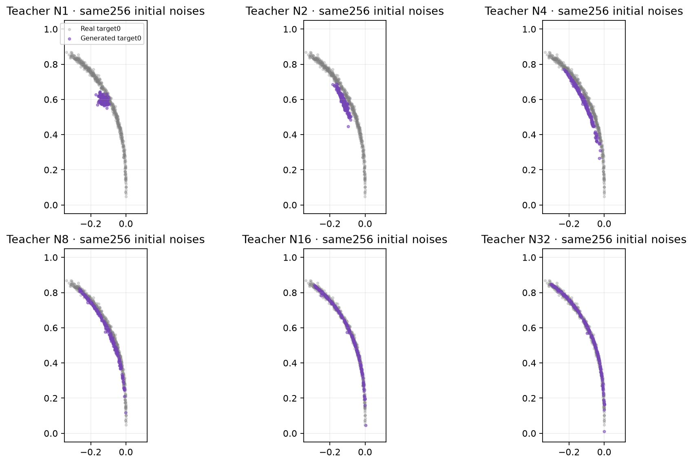
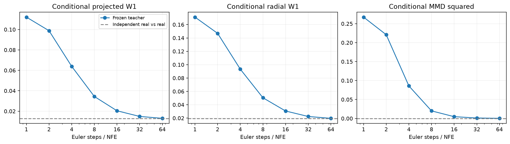

# Сколько шагов нужно conditional-учителю

Проверен тот же опубликованный teacher после 20 000 updates, без переобучения и CFG. У каждого из 16 условий — один и тот же банк 256 Gaussian noises; при смене NFE шум не меняется. Получено 4096 точек на каждый бюджет, reference — независимые 8192 real validation points (512 на условие).

Попадание в запрошенный луч оказалось слабой проверкой: уже один Euler-шаг даёт 100% routing accuracy, при этом точки собираются около середины луча. Число шагов заметно меняет распределение по радиусу и качество внутри каждого condition.

| NFE | Routing accuracy | Средний conditional SWD ↓ | Средний radial W1 ↓ | Средний conditional MMD² ↓ |
|---:|---:|---:|---:|---:|
| 1 | 100.000% | 0.112146 | 0.171224 | 0.267406 |
| 2 | 100.000% | 0.098820 | 0.146910 | 0.221008 |
| 4 | 100.000% | 0.063930 | 0.093329 | 0.0858704 |
| 8 | 100.000% | 0.034429 | 0.050455 | 0.0199747 |
| 16 | 100.000% | 0.020423 | 0.030651 | 0.00467744 |
| 32 | 99.976% | 0.014895 | 0.022435 | 0.00118476 |
| 64 | 99.951% | 0.013032 | 0.019668 | 0.000302312 |
| Real vs independent real | — | 0.012775 | 0.019388 | 5.43844e-06 |

SWD здесь — средний projected W1 в raw x/y, отдельно для каждого условия и затем среднее по 16 условиям. Это не SW2² training loss. RBF bandwidth MMD фиксирован по real train отдельно для каждого condition; использованы те же 1024 проекции на всех NFE. Последняя строка сравнивает независимые реальные выборки того же размера и показывает эмпирический масштаб ошибки конечной выборки. Она не является тестом эквивалентности или заранее выбранным допуском.

При 4 шагах conditional SWD примерно в 4.29 раза больше, чем при 32. Поэтому визуальное приближение к нужному лучу не означает сходимость распределения. N32/N64 уже близки к real-vs-real ориентиру по этим глобальным условным метрикам; точное совпадение толщины и всех распределений из этого не следует. Меньшая средняя фазовая ошибка, чем у real, может означать чрезмерную концентрацию.





## Роль задачи

Conditional «один ID → один тонкий луч» подходит для проверки передачи condition и простого сокращения шагов. Для исследования различий методов полезен стенд с несколькими допустимыми модами при одном condition: например, одинаковые A/B, препятствия и два обхода стены. Тогда измеряются достижение цели, exact segment–wall collisions, длина и разнообразие путей, а также NFE–quality curve. Существующий WallNavigation предоставляет геометрию и collision checks, но его детерминированный A* нужно расширить для нескольких обходов и held-out layouts. Такой новый стенд в этой проверке не обучался.

Это posthoc-диагностика одного фиксированного teacher и одного банка шумов/reference, без выбора checkpoint и без нового формального сравнения loss. Числа не являются повторениями обучения или доказательством эквивалентности при четырёх шагах.

## Повторить

```bash
uv run python examples/evaluate_conditional_teacher_nfe.py
```

[Полные метрики и provenance](metrics.json) · [Сохранённые точки](samples.pt).
