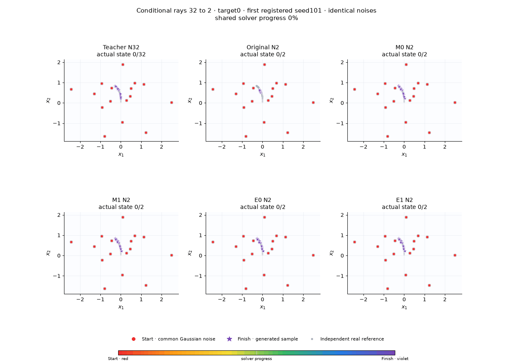
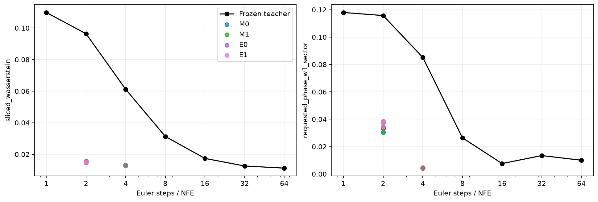

# Conditional rays: 32 → 4 и 32 → 2

На обоих бюджетах дистилляция заметно помогает: одного попадания в нужный луч недостаточно для оценки качества. При двух шагах MSE-ученик уменьшает средний conditional SWD с 0.09639 до 0.01534. На четырёх — с 0.06120 до 0.01301.

Это отдельный conditional pilot: один frozen teacher с 20 000 CFM updates; M0/M1/E0/E1 × три paired training seeds × два бюджета, всего **24 ученика по 1000 updates**. Учитель получает номер целевого луча; condition сохранён в teacher targets, tube retargeting и каждом student-вызове. CFG выключен. Null обучается с вероятностью 0.1, но финальные метрики ниже относятся к заданным условиям.

| Бюджет | Модель | Conditional SWD ↓ | MMD² ↓ | Phase W1 ↓ | Правильный target | MSE к Teacher32 ↓ |
|---|---|---:|---:|---:|---:|---:|
| 4 | Original teacher | 0.061195 | 0.0801446 | 0.085165 | 100.00% | 0.0047736 |
| 4 | M0, mean 3 seeds | 0.013013 | 0.0004243 | 0.004415 | 99.55% | 0.0000529 |
| 4 | M1, mean 3 seeds | 0.013006 | 0.0004202 | 0.004387 | 99.56% | 0.0000526 |
| 4 | E0, mean 3 seeds | 0.012895 | 0.0003567 | 0.004478 | 99.64% | 0.0000639 |
| 4 | E1, mean 3 seeds | 0.012885 | 0.0003510 | 0.004464 | 99.65% | 0.0000636 |
| 2 | Original teacher | 0.096393 | 0.2134771 | 0.115741 | 100.00% | 0.0137171 |
| 2 | M0, mean 3 seeds | 0.015342 | 0.0014872 | 0.032559 | 98.29% | 0.0002615 |
| 2 | M1, mean 3 seeds | 0.015313 | 0.0014749 | 0.032545 | 98.31% | 0.0002605 |
| 2 | E0, mean 3 seeds | 0.015093 | 0.0012926 | 0.036834 | 98.47% | 0.0003272 |
| 2 | E1, mean 3 seeds | 0.015054 | 0.0012746 | 0.036858 | 98.49% | 0.0003258 |

M0 — paired endpoint MSE; M1 — MSE с tube; E0 — MSE + debiased Sinkhorn; E1 — Sinkhorn + tube. Результат — финальная EMA после фиксированного числа updates, без выбора лучшего checkpoint по финальной выборке.

Sinkhorn немного улучшает SWD/MMD относительно MSE, но на двух шагах ухудшает phase W1 и точность воспроизведения родителя. E0−M0 по SWD: −0.0002491, paired 95% t-интервал [−0.0002964, −0.0002018]. По phase W1: **+0.0042756**, интервал [+0.0038089, +0.0047422]. На четырёх шагах SWD-разность −0.0001175 [−0.0001761, −0.0000589], phase-разность неубедительна. Это компромисс метрик, а не универсальная победа OT.

Интервалы рассчитаны по трём training seeds, условно на одном родителе и общей финальной выборке. n=3 — малый pilot; независимых учителей здесь нет. Нельзя заменять повторы обучения множеством сгенерированных точек.

## Что оценивалось

Новая финальная выборка открыта только после проверки всех 24 завершённых native exports: шум seed 940001, reference seed 20047. 256 общих шумов повторяются для всех 16 targets; reference — 512 точек на target. RBF bandwidth оценён только на train, raw-XY SWD использует общий банк из 1024 проекций. Геометрическая принадлежность лучу, внешний coverage, радиальное распределение и ошибка относительно **запрошенного** луча считаются отдельно. Phase W1 использует точки с r>0.25R и нормировку на ширину сектора.

Teacher32 на этой выборке: conditional SWD 0.012584, target accuracy 100%. Его собственный низкий SWD не отменяет геометрическую проверку тонких лучей. Сетка исходного teacher N=1/2/4/8/16/32/64 сохранена в results.json.

Все методы используют один parent SHA `9bc0dbe39c4cb24c4d9b893bac084c89be66fdd7b29d6879fca786b4020d6ce1`; parent frozen, потоки batch/noise/condition/interval попарно проверены. Train-калибровка отдельна для каждого condition/interval, полная OT-support содержит один condition либо обученный null. Ни один label не перемешивается с другим в OT.

## Анимации

Первый зарегистрированный seed 101, target 0, первые 16 общих шумов; selection по качеству нет. Красный — старт, фиолетовый — финал. Кадры соответствуют реальным узлам solver; для методов с меньшим числом шагов состояния удерживаются между узлами, интерполяции нет.

## Воспроизведение

В [notebook13](../../../notebooks/13_conditional_rays_distillation.ipynb) установите STUDENT_STEPS=2 или 4, UPDATES=1000, STUDENT_SEED=101/202/303. Teacher loop и все четыре student loops остаются в ячейках. [Runner](../../../examples/train_conditional_rays_low_nfe.py) исполняет эти же ячейки; [evaluator](../../../examples/evaluate_conditional_rays_low_nfe.py) проверяет завершённость всех 24 моделей до открытия нового final bank. Параметры зафиксированы в [registration](registration.json), точные значения/контрасты — [results.json](results.json), компактная таблица — [metrics.csv](metrics.csv).

Выбранные native EMA опубликованы отдельно в [demo](../../demo/rays16_conditional_low_nfe_v1). В notebook нет весов, wheel или outputs. Optimizer/RNG checkpoints исключены; точный resume из demo невозможен, inference и новое обучение доступны.

Raw walltime непригоден для вывода о скорости методов: два CPU-cohort шли параллельно; на 97.445 s оба процесса приостанавливались для изолированного benchmark новой среды. Факт паузы и её длительность записаны в [benchmark_pause.json](benchmark_pause.json). Результаты обучения от неё не зависят, а сравнение training cost здесь не заявляется.
