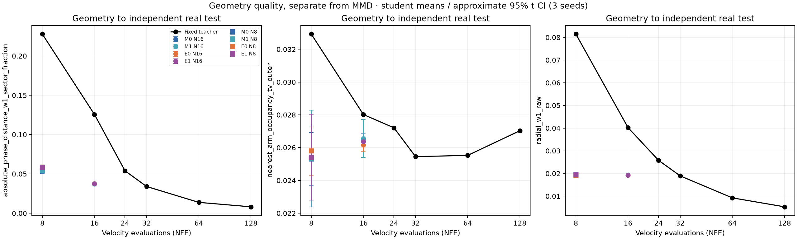
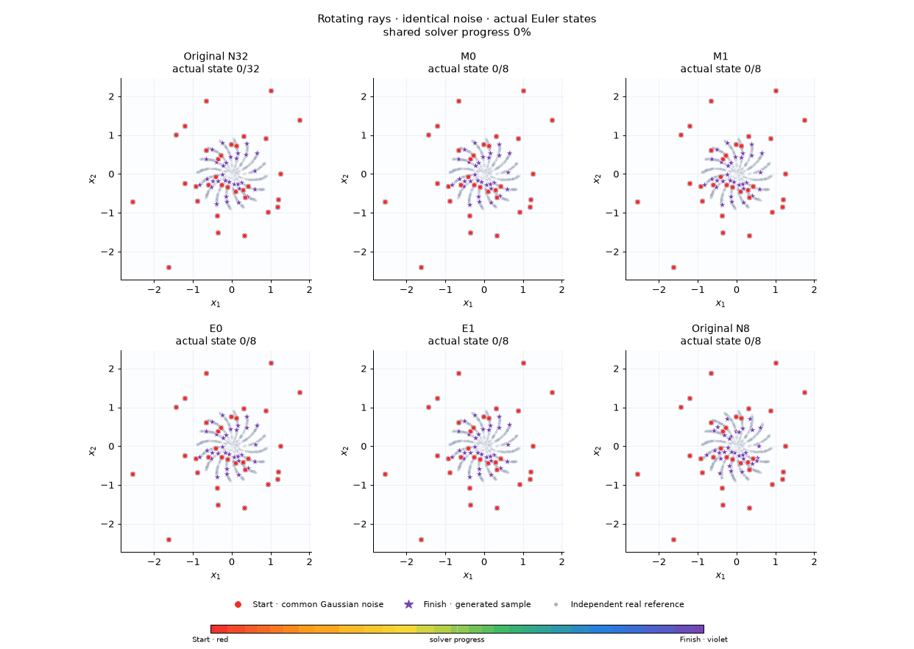

# 16 вращающихся лучей: длинное обучение и дистилляция

Обучен общий unconditional FourierFMMLP на **100 000 updates**, затем **24 ученика по 2500 updates**: MSE / MSE+tube / MSE+Sinkhorn / MSE+Sinkhorn+tube, три seed, две сетки 32→16 и 32→8. Все запуски завершены; teacher frozen и исходные RNG streams проверены. Финальный test открыт после фиксации всех 24 моделей.

[Notebook 12](../../../notebooks/12_many_rays_wasserstein_tube.ipynb) · [Открыть в Colab](https://colab.research.google.com/github/Vovanm88/ddpm_vibe_research/blob/research/wasserstein-tube-replication/notebooks/12_many_rays_wasserstein_tube.ipynb) · [Отдельные native EMA веса](../../demo/README.md)

## Что показало более долгое обучение

Обычная MLP 256×4 после заранее заданных 50k и 100k updates не разделяла тонкие моды достаточно хорошо: промежутки между лучами заполнялись точками. На validation при 100k mean absolute phase error был 0.1978 сектора при N32 и 0.1926 при N128 против 0.01944 у real. Малые MMD/SWD скрывали этот дефект. Результат сохранён как контроль, ученики по нему не обучались.

До запуска учеников зарегистрирован новый общий teacher с фиксированными пространственными Fourier-признаками и гладкими угловыми гармониками. Остались те же данные, seed, ширина/глубина MLP, optimizer и 100k updates. Это обычная PyTorch-модель с Diffusers save_pretrained/from_pretrained; она не получает метки лучей, аналитическое поле или проекцию выхода на кривые. Итоговая модель содержит 216 578 параметров.

Fourier teacher выучил все 16 лучей. При N32 ещё есть межлучевые выбросы; N128 заметно чище, но несколько уже real. Снимок 50k — заранее заданная диагностика, общий финальный parent — фиксированный 100k. Не все метрики монотонно улучшились от 50k к 100k.

[Контроль обычной MLP](teacher_qc/readiness.json) · [Регистрация смены архитектуры](teacher_readiness_amendment.md) · [Fourier teacher, 50k/100k](fourier_teacher_qc/readiness.json)

## Финальный test

Общий банк из 4096 исходных шумов, независимые 8192 real test points. В таблице ученики усреднены по seed 101/202/303; baseline — один общий teacher. MMD² несмещённая, поэтому может быть отрицательной. SWD — projected W1; training SW2² является другой величиной. Phase W1 сравнивает распределения абсолютной ошибки ближайшего луча при r>0.25R, в долях сектора. Для всех трёх столбцов меньше лучше.

| Серия | Метод | NFE | MMD² → real | SWD → real | Phase W1 → real |
|---|---|---:|---:|---:|---:|
| общий teacher | Original N8 | 8 | 0.00500032 | 0.0526437 | 0.227832 |
| общий teacher | Original N16 | 16 | 0.00112786 | 0.0266204 | 0.125567 |
| общий teacher | Original N32 | 32 | 0.000174989 | 0.0134922 | 0.0339666 |
| общий teacher | Original N128 | 128 | -8.55354e-05 | 0.00760703 | 0.00813456 |
| 32→16 | M0 | 16 | 0.000188518 | 0.0137817 | 0.0372905 |
| 32→16 | M1 | 16 | 0.000188499 | 0.0137796 | 0.0372648 |
| 32→16 | E0 | 16 | 0.000185793 | 0.013734 | 0.0375995 |
| 32→16 | E1 | 16 | 0.000186223 | 0.0137378 | 0.037538 |
| 32→8 | M0 | 8 | 0.000188635 | 0.0138889 | 0.0538 |
| 32→8 | M1 | 8 | 0.000188644 | 0.0139139 | 0.0539343 |
| 32→8 | E0 | 8 | 0.000185866 | 0.0138543 | 0.0579012 |
| 32→8 | E1 | 8 | 0.000186371 | 0.0138926 | 0.0581636 |

Все четыре метода заметно лучше прямого сокращения Euler-сетки до того же NFE. Например, при 8 шагах phase W1 у обычного MSE-ученика — 0.05380 против 0.22783 у Original N8. При 16 шагах — 0.03729 против 0.12557 у Original N16. Ошибки parent N32 полностью не исчезают.

**Sinkhorn дал небольшой выигрыш по глобальным MMD/SWD, но ухудшил точность формы лучей.** E0−M0 по MMD²: −2.725e−6 при 16 шагах, paired 95% CI [−3.903e−6, −1.548e−6]. При этом phase W1 вырос на 0.000309, CI [0.0000567, 0.0005613]. При 8 шагах ухудшение phase W1 больше: +0.004101, CI [0.003564, 0.004639]; occupancy TV тоже немного хуже. Радиальное W1 у E0 немного лучше. Это компромисс между метриками, общего преимущества OT здесь не установлено.

При 8 шагах SWD-контраст E0−M0 имеет CI [−0.0000761, +0.0000069], включающий ноль.
Fidelity к parent N32 от добавки OT не улучшилась: при 8 шагах paired endpoint MSE
в среднем 0.00014050 у E0 против 0.00012737 у M0.

Для tube нет устойчивого преимущества по MMD: M1−M0 CI включает ноль на обеих сетках. Полная local/rollout/perturbation диагностика сохранена отдельно; утверждение о robustness не выводится из одной quality-метрики.

Три seed дают пилотные интервалы **условно на одном teacher**, одной real-reference выборке и общем noise bank. Это не три независимо обученных teacher и не доказательство переноса результата на MNIST.



[Все геометрические строки](fourier_geometry/geometry_per_seed.csv) · [Парные геометрические контрасты и CI](fourier_geometry/paired_geometry.csv) · [Полный отчёт 32→16](main32_16/REPORT.md) · [Полный отчёт 32→8](stress32_8/REPORT.md)

## Стоимость и анимации

Общий Fourier teacher: 345.5 s полного запуска, 341.7 s внутри измеряемого training loop. Он обучен один раз и переиспользован в обеих сериях. На CPU после прогрева изолированное обновление MSE занимало 3.895 ms, Sinkhorn — 28.827 ms, примерно в 7.4 раза больше. Финальные студенты обучались двумя независимыми CPU-процессами по четыре потока; их wall time отражает эту конкуренцию: M0 в среднем 11.1/13.3 s, E0 — 80.7/84.5 s для 32→16 / 32→8. Latency генерации измерена последовательно, без параллельного обучения.

В GIF показаны первые 32 зарегистрированных latents для seed 101, без выбора по качеству. Красный — Gaussian start, фиолетовый — generated finish. Кадры являются сохранёнными состояниями Euler, оси общие, между узлами нет интерполяции. В notebook есть Play/Slider с шагом один.



[Анимация 32→16](main32_16/trajectories_comparison.gif) · [Время и фиксация моделей](core_evaluation_timings.json) · [Training completion](training_completion.json)

## Запуск и изменение эксперимента

В notebook 12 виден полный Torch training step: создание фактического anchor, teacher microsteps, tube retargeting, loss, backward, optimizer.step и EMA. Можно заменить модель, loss, число шагов и представление endpoint/displacement/joint. По умолчанию это короткий интерактивный запуск четырёх новых учеников на одном seed; официальная серия выше использовала 2500 updates и три seed. Веса загружаются отдельными Safetensors, wheel и бинарные веса в notebook не встроены.

```bash
uv sync --extra replication --extra interactive --extra dev
# Новый teacher: train-teacher → teacher-gate → calibrate для main config.
# Для stress используется точная копия этого teacher; рецепт есть в notebook 12.
uv run python -m recheck.cli distill-suite --config replication/configs/many_rays_fourier_cpu.yaml
uv run python -m recheck.cli distill-suite --config replication/configs/many_rays_fourier_stress_32_8.yaml
# Оценка после фиксации всех 24 учеников:
uv run python -m recheck.cli evaluate-suite --config replication/configs/many_rays_fourier_cpu.yaml
uv run python -m recheck.cli evaluate-suite --config replication/configs/many_rays_fourier_stress_32_8.yaml
uv run python examples/evaluate_ray_geometry.py \
  --config replication/configs/many_rays_fourier_cpu.yaml \
  --other-config replication/configs/many_rays_fourier_stress_32_8.yaml \
  --output replication/reports/many_rays/fourier_geometry
```

Опубликованные native EMA пригодны для генерации и новых экспериментов. Они не содержат optimizer/RNG state, поэтому точный resume официального обучения из demo невозможен; полные локальные training checkpoints оставлены в ignored artifacts. Полный код MNIST сохранён, но длительный запуск остановлен по уточнению пользователя, Test MNIST не открывался. Apple MPS доступен и отдельно проверен на forward/backward/native reload и OT gradient parity; этот небольшой стенд выполнен на CPU.

Проверка реализации при завершении этой серии: **551 passed, 3 skipped**, 45.73 s. GPU-dependent skips дополнены фактическими MPS smoke/parity reports; Ruff для src/tests/examples и новых notebooks проходит.

Дополнительно [notebook 12 выполнен целиком](notebook12_native_smoke.json) с опубликованным
100k teacher: все 15 code cells, четыре новых ученика по 200 updates, интерактивные
widgets и шесть GIF. Проверены frozen teacher, парные RNG и native EMA reload;
notebook и официальные артефакты не изменились. Полный запуск занял 50.9 s на CPU.
