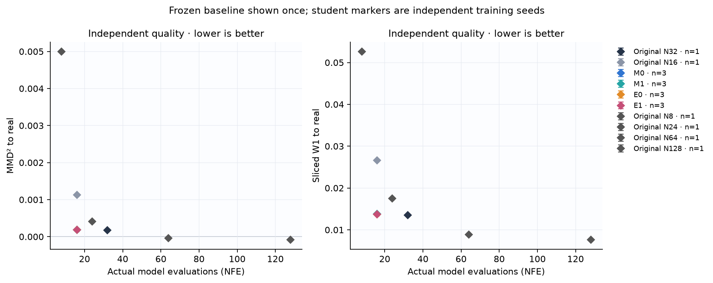
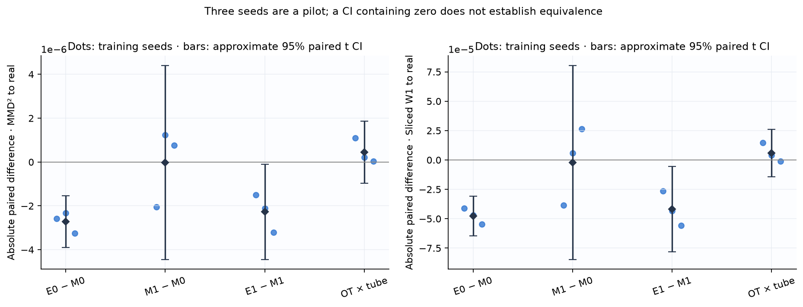
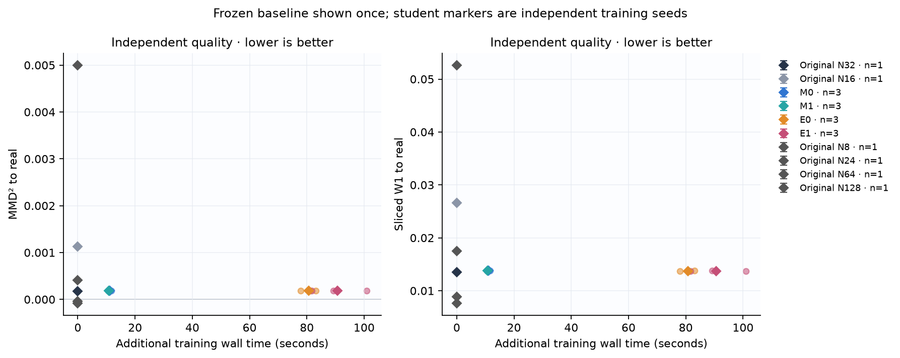
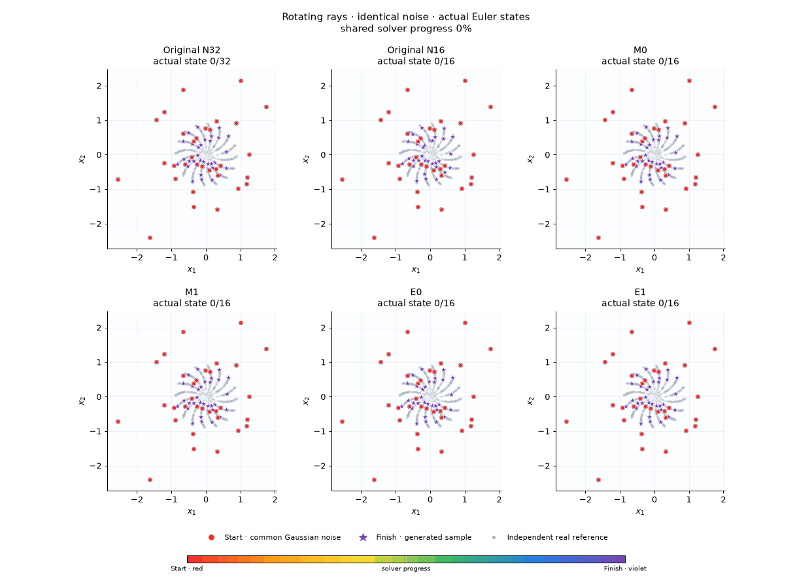
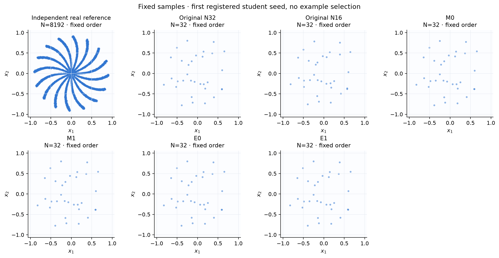
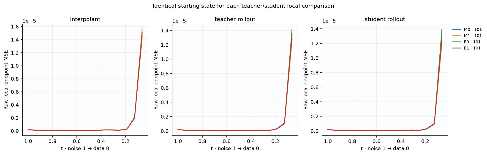
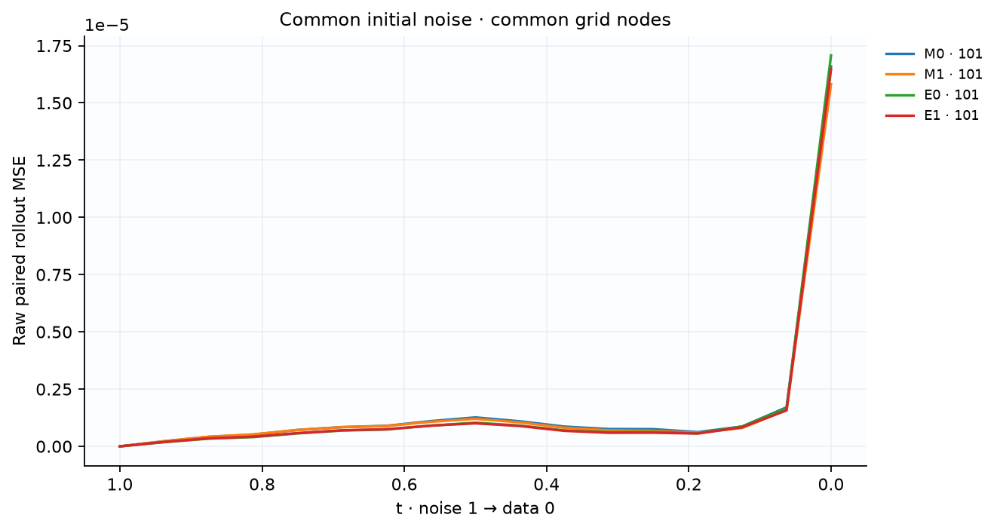
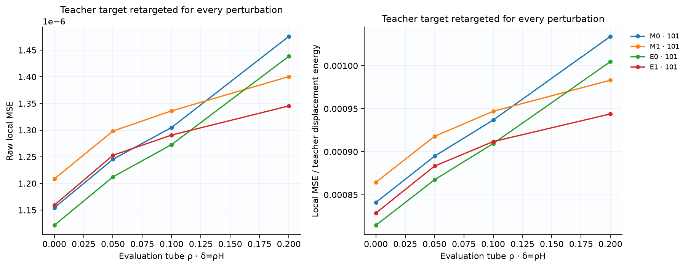
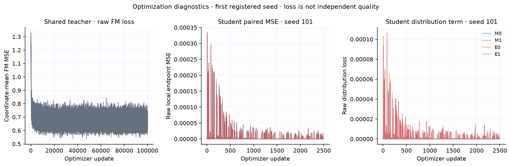

# Контролируемый пилот на вращающихся лучах

Это независимая реализация протокола [P] из REPLICATION_SPEC.md. Числа ниже получены на вращающихся лучах; это не результаты MNIST и не буквальное воспроизведение диплома.

**Основной MNIST-контраст E0 − M0: not_tested.** Полная MNIST-серия не выполнена на CPU. Результаты этого пилота проверяют реализацию и показывают поведение на малом стенде; они не устанавливают перенос на MNIST.

Зафиксированы один общий teacher и 3 student seed: `[101, 202, 303]`. Выбор анимаций: первый зарегистрированный seed `101`, без выбора по качеству. Все методы и NFE используют общий исходный шум; real reference независима от генераций.

Protocol: `rays16_fourier_teacher_v1`. Teacher SHA: `495ff88057d8a5dccbc1581d887404332e9f24ba4dfad658f730de389323b93a`. Noise SHA: `85a93e7069e4befd116281d4acd527de796a642bde2f14ae572fb14437c1c4d5`.

## Качество относительно реальных данных

MMD² — несмещённая двухвыборочная оценка с фиксированным train-only RBF; отрицательные значения допустимы и сохранены. SWD здесь — среднее projected W1 существующего проекта, 1024 фиксированных независимых направления; это другая величина, чем squared SW2 training loss.

| Метод | Student seed | NFE | MMD² → real | SWD → real |
|---|---:|---:|---:|---:|
| Original N8 | frozen baseline | 8 | 0.00500032 | 0.0526437 |
| Original N16 | frozen baseline | 16 | 0.00112786 | 0.0266204 |
| Original N24 | frozen baseline | 24 | 0.000413051 | 0.0175393 |
| Original N32 | frozen baseline | 32 | 0.000174989 | 0.0134922 |
| Original N64 | frozen baseline | 64 | -3.96666e-05 | 0.00888864 |
| Original N128 | frozen baseline | 128 | -8.55354e-05 | 0.00760703 |
| M0 | 101 | 16 | 0.000188424 | 0.0137695 |
| M1 | 101 | 16 | 0.000186367 | 0.0137308 |
| E0 | 101 | 16 | 0.000185834 | 0.0137282 |
| E1 | 101 | 16 | 0.000184872 | 0.0137043 |
| M0 | 202 | 16 | 0.000188086 | 0.0138028 |
| M1 | 202 | 16 | 0.000189329 | 0.0138087 |
| E0 | 202 | 16 | 0.000185753 | 0.0137557 |
| E1 | 202 | 16 | 0.000187211 | 0.0137656 |
| M0 | 303 | 16 | 0.000189043 | 0.0137727 |
| M1 | 303 | 16 | 0.0001898 | 0.0137991 |
| E0 | 303 | 16 | 0.000185791 | 0.013718 |
| E1 | 303 | 16 | 0.000186584 | 0.0137434 |

## Парные различия между независимыми обучениями

Отрицательное различие благоприятно для первого метода. Интервал — приближённый paired t CI по seed; три seed являются пилотом. Интервал, включающий ноль, не доказывает эквивалентность. Относительные проценты от MMD не вычисляются.

| Контраст | Метрика | Парные значения по seed | Mean | Sample std | 95% CI |
|---|---|---|---:|---:|---|
| E0_minus_M0 | mmd2_real | -2.59023e-06, -2.33313e-06, -3.25187e-06 | -2.72508e-06 | 4.73982e-07 | [-3.90251e-06, -1.54764e-06] |
| M1_minus_M0 | mmd2_real | -2.0575e-06, 1.2432e-06, 7.57777e-07 | -1.88397e-08 | 1.78213e-06 | [-4.4459e-06, 4.40822e-06] |
| E1_minus_M1 | mmd2_real | -1.49407e-06, -2.11799e-06, -3.21634e-06 | -2.27613e-06 | 8.7196e-07 | [-4.4422e-06, -1.10066e-07] |
| OT_x_tube_interaction | mmd2_real | 1.09617e-06, 2.15134e-07, 3.55258e-08 | 4.48942e-07 | 5.67661e-07 | [-9.61206e-07, 1.85909e-06] |
| E0_minus_M0 | sliced_wasserstein | -4.12481e-05, -4.7065e-05, -5.4733e-05 | -4.7682e-05 | 6.76359e-06 | [-6.44837e-05, -3.08804e-05] |
| M1_minus_M0 | sliced_wasserstein | -3.86226e-05, 5.93322e-06, 2.63908e-05 | -2.09954e-06 | 3.32427e-05 | [-8.4679e-05, 8.04799e-05] |
| E1_minus_M1 | sliced_wasserstein | -2.65045e-05, -4.3135e-05, -5.57599e-05 | -4.17998e-05 | 1.46734e-05 | [-7.82505e-05, -5.34912e-06] |
| OT_x_tube_interaction | sliced_wasserstein | 1.47437e-05, 3.93002e-06, -1.02692e-06 | 5.88226e-06 | 8.06451e-06 | [-1.41511e-05, 2.59156e-05] |

## Fidelity относительно общего teacher

Fidelity измеряет воспроизведение teacher при общем шуме; улучшение fidelity само по себе не означает улучшение качества относительно данных. Raw MSE считается без clamp.

| Метод | Student seed | NFE | Paired endpoint MSE |
|---|---:|---:|---:|
| Original N8 | frozen | 8 | 0.00353566 |
| Original N16 | frozen | 16 | 0.000748582 |
| Original N24 | frozen | 24 | 0.00010154 |
| Original N32 | frozen | 32 | 0 |
| Original N64 | frozen | 64 | 0.000236878 |
| Original N128 | frozen | 128 | 0.000420098 |
| M0 | 101 | 16 | 3.57969e-05 |
| M1 | 101 | 16 | 3.60751e-05 |
| E0 | 101 | 16 | 3.53004e-05 |
| E1 | 101 | 16 | 3.55593e-05 |
| M0 | 202 | 16 | 3.35124e-05 |
| M1 | 202 | 16 | 3.35948e-05 |
| E0 | 202 | 16 | 3.3961e-05 |
| E1 | 202 | 16 | 3.39173e-05 |
| M0 | 303 | 16 | 3.45616e-05 |
| M1 | 303 | 16 | 3.43058e-05 |
| E0 | 303 | 16 | 3.48023e-05 |
| E1 | 303 | 16 | 3.4436e-05 |

## Стоимость

Время обучения teacher является общей стоимостью. В таблице training wall time ученика — дополнительная стоимость; frozen baseline не считается отдельным повторным обучением. Timings относятся к указанному batch и этому оборудованию. NFE — число последовательных evaluations для одного примера; total model calls дополнительно учитывает разбиение всего набора на batches.

| Метод | Seed | NFE / sample | Total model calls | Training seconds | Median generation seconds |
|---|---:|---:|---:|---:|---:|
| Original N8 | frozen | 8 | 256 | 341.698 | 0.00384896 |
| Original N16 | frozen | 16 | 512 | 341.698 | 0.00790346 |
| Original N24 | frozen | 24 | 768 | 341.698 | 0.0109544 |
| Original N32 | frozen | 32 | 1024 | 341.698 | 0.0147931 |
| Original N64 | frozen | 64 | 2048 | 341.698 | 0.029497 |
| Original N128 | frozen | 128 | 4096 | 341.698 | 0.0598049 |
| M0 | 101 | 16 | 512 | 10.6145 | 0.00742604 |
| M1 | 101 | 16 | 512 | 10.7601 | 0.00762038 |
| E0 | 101 | 16 | 512 | 77.8772 | 0.0074245 |
| E1 | 101 | 16 | 512 | 81.6525 | 0.00758892 |
| M0 | 202 | 16 | 512 | 11.6843 | 0.00778904 |
| M1 | 202 | 16 | 512 | 11.1129 | 0.00781092 |
| E0 | 202 | 16 | 512 | 83.1071 | 0.007981 |
| E1 | 202 | 16 | 512 | 89.2449 | 0.00778362 |
| M0 | 303 | 16 | 512 | 11.0227 | 0.0077255 |
| M1 | 303 | 16 | 512 | 10.5606 | 0.00752396 |
| E0 | 303 | 16 | 512 | 81.1575 | 0.00765104 |
| E1 | 303 | 16 | 512 | 100.973 | 0.00783229 |

## Реальные траектории

Начало красное, конец фиолетовый. Кружки — общий Gaussian noise, звёзды — финальные точки. Кадры выбирают сохранённые состояния Euler; между узлами нет интерполяции. Все панели имеют одинаковые оси. Фиксированный первый seed не является выбором лучшего запуска.

## Диагностика и ограничения

Local error сравнивает teacher/student из одного и того же anchor. Рассматриваются interpolant, реальный teacher rollout и method-dependent student rollout. Для robustness teacher target пересчитывается после каждого возмущения; tube имеет δ=ρH на координату. Линейный интерполянт пары данных и шума не является индивидуальной ODE-траекторией маргинального поля.

Один teacher ограничивает выводы этим teacher. Три student seed недостаточны для универсального ранжирования. Ученики оцениваются на зарегистрированной сетке; frozen original на той же короткой сетке нужен для сравнения практической полезности. Снижение training loss, local error или совпадение с teacher не заменяет независимую оценку качества.

Основные H1–H4 для unconditional pixel MNIST остаются `not_tested`; сравнения лучей являются отдельным диагностическим пилотом. H3 (все пространства endpoint/displacement/joint) не проверяется матрицей MVP.

## Данные и воспроизведение отчёта

Таблицы автоматически построены из `evaluation/results.json`; парные различия сохранены в `paired_comparisons.csv`, отдельные строки — в `results_per_seed.csv`, происхождение кадров — в `animations_manifest.json`. Используются только сохранённые метрики и траектории; отчёт не обучает и не выбирает примеры.

Команда: `python -m recheck.cli report --runs replication/artifacts/rays16_fourier_teacher_v1 --output <report_dir>/REPORT.md`.

## Кривые локальной ошибки, rollout и robustness

Student rollout anchors зависят от метода. Для каждого local сравнения вход у teacher/student общий; при каждом rho target пересчитывается. Производные, если измерены, следует читать вместе с проверкой при ζ/2.

## Наблюдаемая оптимизация

Loss служит диагностикой оптимизации; вывод о качестве основан на независимых quality metrics.
