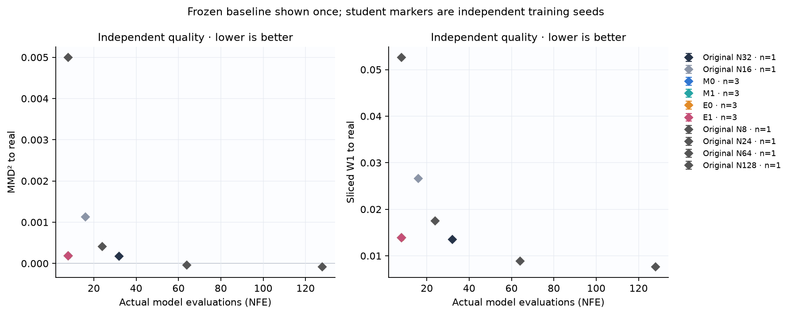
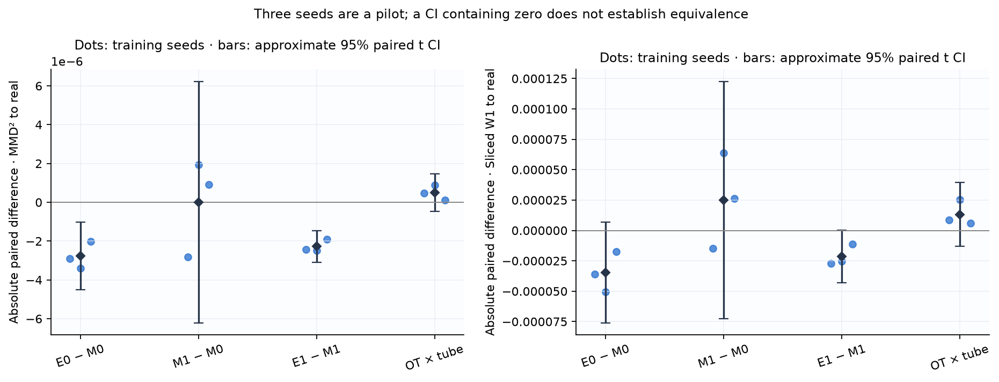
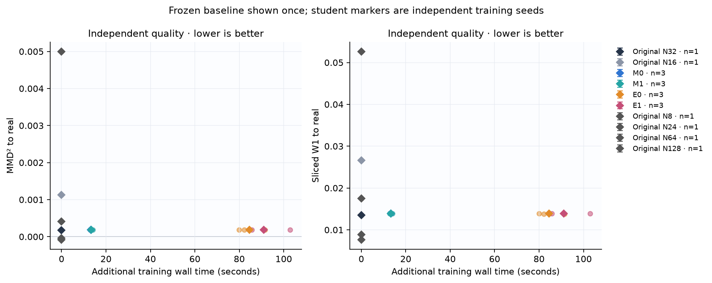
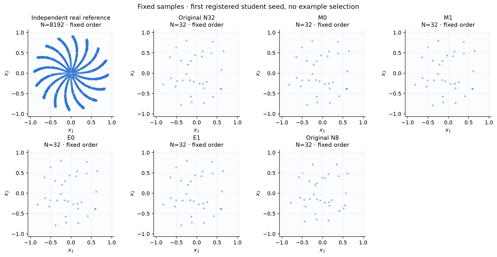
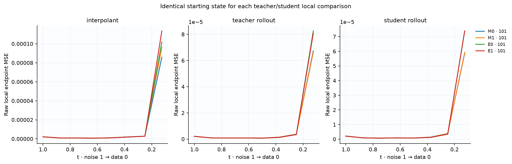
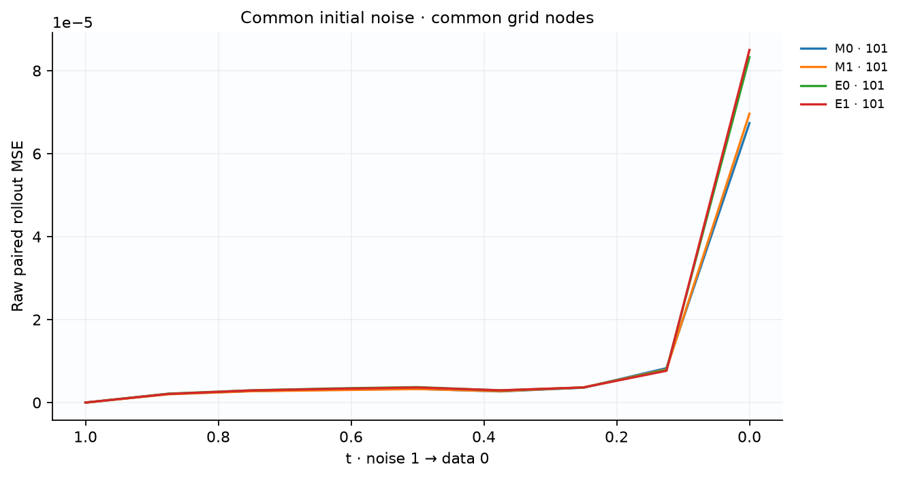
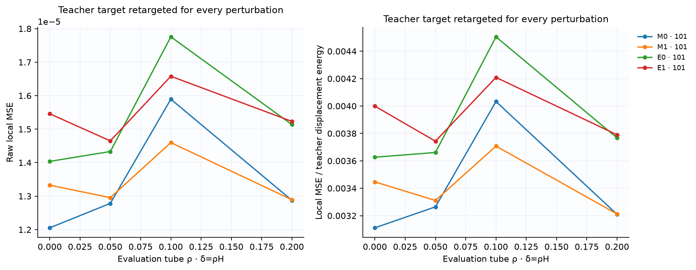
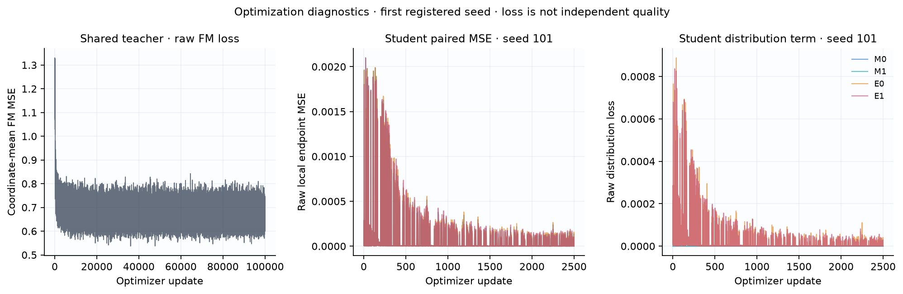

# Контролируемый пилот на вращающихся лучах

Это независимая реализация протокола [P] из REPLICATION_SPEC.md. Числа ниже получены на вращающихся лучах; это не результаты MNIST и не буквальное воспроизведение диплома.

**Основной MNIST-контраст E0 − M0: not_tested.** Полная MNIST-серия не выполнена на CPU. Результаты этого пилота проверяют реализацию и показывают поведение на малом стенде; они не устанавливают перенос на MNIST.

Зафиксированы один общий teacher и 3 student seed: `[101, 202, 303]`. Выбор анимаций: первый зарегистрированный seed `101`, без выбора по качеству. Все методы и NFE используют общий исходный шум; real reference независима от генераций.

Protocol: `rays16_fourier_teacher_stress8_v1`. Teacher SHA: `495ff88057d8a5dccbc1581d887404332e9f24ba4dfad658f730de389323b93a`. Noise SHA: `85a93e7069e4befd116281d4acd527de796a642bde2f14ae572fb14437c1c4d5`.

## Качество относительно реальных данных

MMD² — несмещённая двухвыборочная оценка с фиксированным train-only RBF; отрицательные значения допустимы и сохранены. SWD здесь — среднее projected W1 существующего проекта, 1024 фиксированных независимых направления; это другая величина, чем squared SW2 training loss.

| Метод | Student seed | NFE | MMD² → real | SWD → real |
|---|---:|---:|---:|---:|
| Original N8 | frozen baseline | 8 | 0.00500032 | 0.0526437 |
| Original N16 | frozen baseline | 16 | 0.00112786 | 0.0266204 |
| Original N24 | frozen baseline | 24 | 0.000413051 | 0.0175393 |
| Original N32 | frozen baseline | 32 | 0.000174989 | 0.0134922 |
| Original N64 | frozen baseline | 64 | -3.96666e-05 | 0.00888864 |
| Original N128 | frozen baseline | 128 | -8.55354e-05 | 0.00760703 |
| M0 | 101 | 8 | 0.000192967 | 0.0139533 |
| M1 | 101 | 8 | 0.000190141 | 0.0139383 |
| E0 | 101 | 8 | 0.000190072 | 0.0139175 |
| E1 | 101 | 8 | 0.000187721 | 0.0139111 |
| M0 | 202 | 8 | 0.000185614 | 0.0138525 |
| M1 | 202 | 8 | 0.00018754 | 0.0139161 |
| E0 | 202 | 8 | 0.000182215 | 0.0138019 |
| E1 | 202 | 8 | 0.00018504 | 0.0138907 |
| M0 | 303 | 8 | 0.000187324 | 0.0138609 |
| M1 | 303 | 8 | 0.000188251 | 0.0138873 |
| E0 | 303 | 8 | 0.00018531 | 0.0138436 |
| E1 | 303 | 8 | 0.000186352 | 0.0138759 |

## Парные различия между независимыми обучениями

Отрицательное различие благоприятно для первого метода. Интервал — приближённый paired t CI по seed; три seed являются пилотом. Интервал, включающий ноль, не доказывает эквивалентность. Относительные проценты от MMD не вычисляются.

| Контраст | Метрика | Парные значения по seed | Mean | Sample std | 95% CI |
|---|---|---|---:|---:|---|
| E0_minus_M0 | mmd2_real | -2.89453e-06, -3.39915e-06, -2.01351e-06 | -2.76906e-06 | 7.0129e-07 | [-4.51116e-06, -1.02696e-06] |
| M1_minus_M0 | mmd2_real | -2.82529e-06, 1.92601e-06, 9.27011e-07 | 9.24337e-09 | 2.50508e-06 | [-6.21372e-06, 6.23221e-06] |
| E1_minus_M1 | mmd2_real | -2.42078e-06, -2.50021e-06, -1.89814e-06 | -2.27304e-06 | 3.271e-07 | [-3.0856e-06, -1.46048e-06] |
| OT_x_tube_interaction | mmd2_real | 4.73749e-07, 8.98935e-07, 1.15371e-07 | 4.96018e-07 | 3.92257e-07 | [-4.78401e-07, 1.47044e-06] |
| E0_minus_M0 | sliced_wasserstein | -3.578e-05, -5.06411e-05, -1.73049e-05 | -3.45754e-05 | 1.67007e-05 | [-7.60623e-05, 6.91156e-06] |
| M1_minus_M0 | sliced_wasserstein | -1.49989e-05, 6.35975e-05, 2.6426e-05 | 2.50082e-05 | 3.93174e-05 | [-7.26616e-05, 0.000122678] |
| E1_minus_M1 | sliced_wasserstein | -2.72598e-05, -2.53826e-05, -1.14436e-05 | -2.1362e-05 | 8.64072e-06 | [-4.28268e-05, 1.02724e-07] |
| OT_x_tube_interaction | sliced_wasserstein | 8.5202e-06, 2.52585e-05, 5.8613e-06 | 1.32133e-05 | 1.05158e-05 | [-1.29094e-05, 3.9336e-05] |

## Fidelity относительно общего teacher

Fidelity измеряет воспроизведение teacher при общем шуме; улучшение fidelity само по себе не означает улучшение качества относительно данных. Raw MSE считается без clamp.

| Метод | Student seed | NFE | Paired endpoint MSE |
|---|---:|---:|---:|
| Original N8 | frozen | 8 | 0.00353566 |
| Original N16 | frozen | 16 | 0.000748582 |
| Original N24 | frozen | 24 | 0.00010154 |
| Original N32 | frozen | 32 | 0 |
| Original N64 | frozen | 64 | 0.000236878 |
| Original N128 | frozen | 128 | 0.000420098 |
| M0 | 101 | 8 | 0.000128383 |
| M1 | 101 | 8 | 0.000126452 |
| E0 | 101 | 8 | 0.000142297 |
| E1 | 101 | 8 | 0.000141286 |
| M0 | 202 | 8 | 0.000128143 |
| M1 | 202 | 8 | 0.000139033 |
| E0 | 202 | 8 | 0.000139368 |
| E1 | 202 | 8 | 0.000149006 |
| M0 | 303 | 8 | 0.000125583 |
| M1 | 303 | 8 | 0.000123156 |
| E0 | 303 | 8 | 0.000139847 |
| E1 | 303 | 8 | 0.000137243 |

## Стоимость

Время обучения teacher является общей стоимостью. В таблице training wall time ученика — дополнительная стоимость; frozen baseline не считается отдельным повторным обучением. Timings относятся к указанному batch и этому оборудованию. NFE — число последовательных evaluations для одного примера; total model calls дополнительно учитывает разбиение всего набора на batches.

| Метод | Seed | NFE / sample | Total model calls | Training seconds | Median generation seconds |
|---|---:|---:|---:|---:|---:|
| Original N8 | frozen | 8 | 256 | 341.698 | 0.00412212 |
| Original N16 | frozen | 16 | 512 | 341.698 | 0.007326 |
| Original N24 | frozen | 24 | 768 | 341.698 | 0.0108529 |
| Original N32 | frozen | 32 | 1024 | 341.698 | 0.0147726 |
| Original N64 | frozen | 64 | 2048 | 341.698 | 0.0297304 |
| Original N128 | frozen | 128 | 4096 | 341.698 | 0.0603232 |
| M0 | 101 | 8 | 256 | 12.9374 | 0.00373883 |
| M1 | 101 | 8 | 256 | 12.9981 | 0.00409317 |
| E0 | 101 | 8 | 256 | 79.9135 | 0.00388658 |
| E1 | 101 | 8 | 256 | 84.6154 | 0.00375288 |
| M0 | 202 | 8 | 256 | 13.6144 | 0.00393704 |
| M1 | 202 | 8 | 256 | 12.8347 | 0.00415871 |
| E0 | 202 | 8 | 256 | 91.4769 | 0.00372304 |
| E1 | 202 | 8 | 256 | 85.6667 | 0.00383704 |
| M0 | 303 | 8 | 256 | 13.2253 | 0.00371442 |
| M1 | 303 | 8 | 256 | 14.004 | 0.00379658 |
| E0 | 303 | 8 | 256 | 82.1989 | 0.00425758 |
| E1 | 303 | 8 | 256 | 102.933 | 0.00374117 |

## Реальные траектории

Начало красное, конец фиолетовый. Кружки — общий Gaussian noise, звёзды — финальные точки. Кадры выбирают сохранённые состояния Euler; между узлами нет интерполяции. Все панели имеют одинаковые оси. Фиксированный первый seed не является выбором лучшего запуска.

## Диагностика и ограничения

Local error сравнивает teacher/student из одного и того же anchor. Рассматриваются interpolant, реальный teacher rollout и method-dependent student rollout. Для robustness teacher target пересчитывается после каждого возмущения; tube имеет δ=ρH на координату. Линейный интерполянт пары данных и шума не является индивидуальной ODE-траекторией маргинального поля.

Один teacher ограничивает выводы этим teacher. Три student seed недостаточны для универсального ранжирования. Ученики оцениваются на зарегистрированной сетке; frozen original на той же короткой сетке нужен для сравнения практической полезности. Снижение training loss, local error или совпадение с teacher не заменяет независимую оценку качества.

Основные H1–H4 для unconditional pixel MNIST остаются `not_tested`; сравнения лучей являются отдельным диагностическим пилотом. H3 (все пространства endpoint/displacement/joint) не проверяется матрицей MVP.

## Данные и воспроизведение отчёта

Таблицы автоматически построены из `evaluation/results.json`; парные различия сохранены в `paired_comparisons.csv`, отдельные строки — в `results_per_seed.csv`, происхождение кадров — в `animations_manifest.json`. Используются только сохранённые метрики и траектории; отчёт не обучает и не выбирает примеры.

Команда: `python -m recheck.cli report --runs replication/artifacts/rays16_fourier_teacher_stress8_v1 --output <report_dir>/REPORT.md`.

## Кривые локальной ошибки, rollout и robustness

Student rollout anchors зависят от метода. Для каждого local сравнения вход у teacher/student общий; при каждом rho target пересчитывается. Производные, если измерены, следует читать вместе с проверкой при ζ/2.

## Наблюдаемая оптимизация

Loss служит диагностикой оптимизации; вывод о качестве основан на независимых quality metrics.
