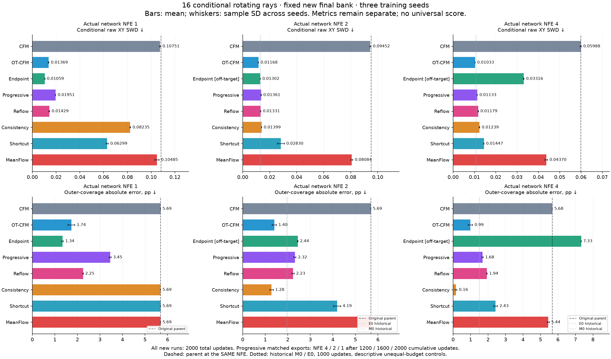
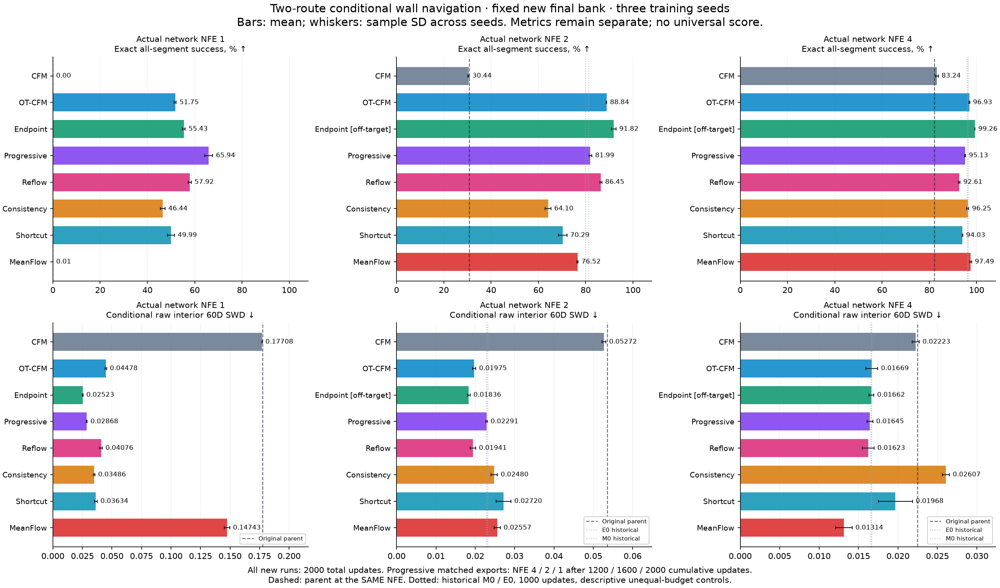
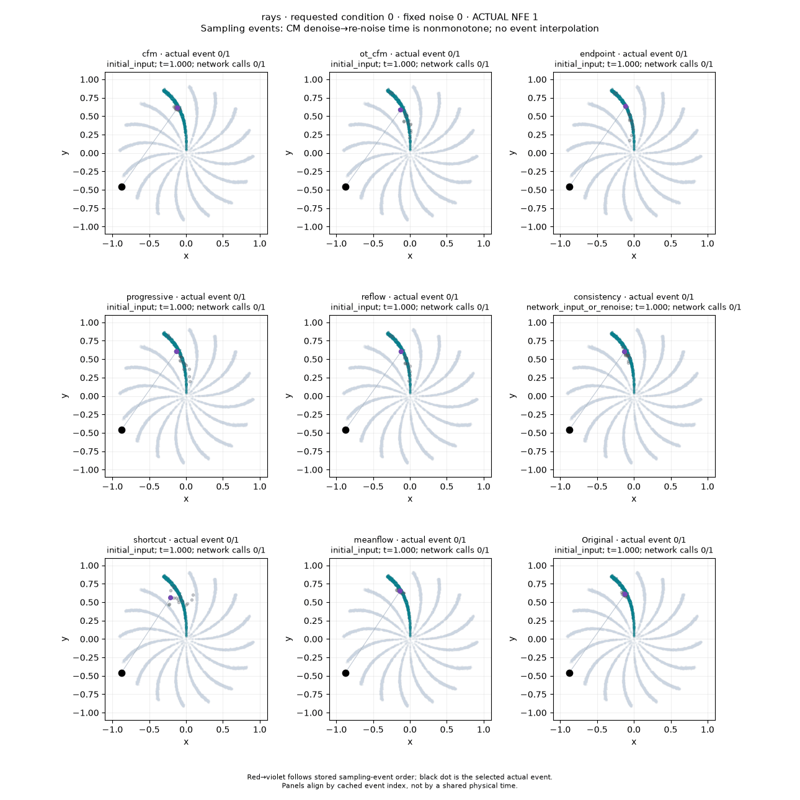
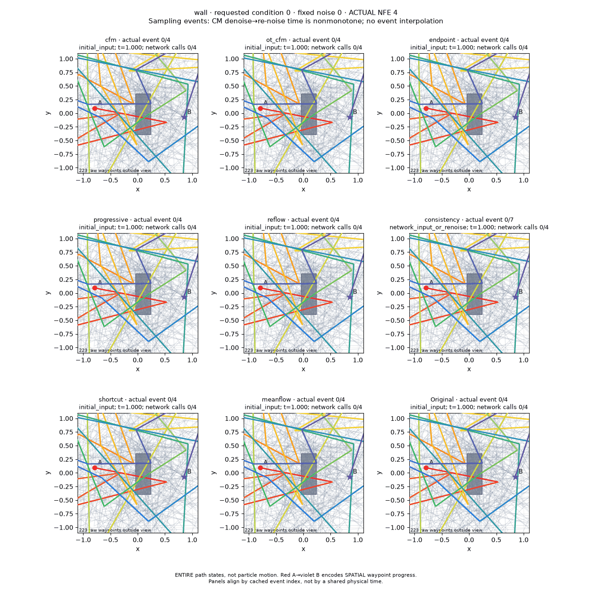

# Conditional method zoo: 16 лучей и два обхода стены

**Для лучей практический старт — Endpoint при одном вызове, OT-CFM при двух
или четырёх. Для стены — Progressive при одном вызове, OT-CFM при двух и
MeanFlow при четырёх в их native-режимах.** Если разрешена off-target генерация
Endpoint, он даёт больше допустимых wall-путей при NFE 2 / 4, но на лучах
дополнительные шаги этого метода ухудшают распределение.

Все **168 финальных измерений завершены**: 144 новых, восемь parent baselines
и 16 исторических references. Все 48 новых обучений и 144 inference-экспорта
зафиксированы до открытия новых финальных banks. Это рекомендации по данному
рецепту и короткому бюджету, без утверждения об универсальном лучшем методе.

## Что выбрать для следующего исследования

| Задача | Вызовов сети | Практический выбор | Качество и существенный компромисс |
|---|---:|---|---|
| 16 лучей | 1 | **Endpoint** | SWD 0.01059, outer routing 99.87%; близок к parent32 по распределению, остаётся ошибка внешней массы 1.34 п.п. |
| 16 лучей | 2 | **OT-CFM**; Progressive, если важнее угловая точность | SWD 0.01168 и routing 99.59%; Progressive имеет SWD 0.01361, routing 99.987% и меньшую phase-ошибку |
| 16 лучей | 4 | **OT-CFM** для распределения; **Progressive** для тонкой геометрии | SWD 0.01033 против 0.01133, radial W1 0.00744 против 0.01020; phase-distance W1 0.01549 против 0.00323 |
| Стена | 1 | **Progressive** | 65.94% допустимых путей; 34.06% всё ещё неуспешны. Endpoint даёт меньший SWD, но лишь 55.43% success |
| Стена | 2 | **OT-CFM** в native-режиме; Endpoint off-target как отдельная альтернатива | 88.84% / SWD 0.01975 против 91.82% / 0.01836; у Progressive лучше баланс мод, но success 81.99% |
| Стена | 4 | **MeanFlow** в native-режиме; Endpoint off-target для максимума success | MeanFlow: 97.49% / SWD 0.01314 / balance TV 0.01484; Endpoint: 99.26% / 0.01662 / 0.02269 |

Здесь «лучше» всегда относится к конкретным метрикам. Например, Pareto-слой 1
на лучах включает и CFM с почти идеальным routing, но сильно искажённым
радиальным распределением. Его присутствие на фронте само по себе не делает
его хорошим distribution sampler. Для стены при NFE 2 / 4 **все новые методы
показывают оба успешных обхода во всех 32 сценах**: этот критерий уже насыщен
и не заменяет долю допустимых путей или баланс мод.

## Результаты на новых финальных banks

В таблицах **среднее ± sample standard deviation по трём training seeds**.
SWD — conditional raw-space sliced W1, меньше лучше. Стандартное отклонение
характеризует повторяемость обучения при фиксированных parent и final bank.
Полные geometry/routing/phase метрики и t95-интервалы есть в
[primary_summary.csv](final/primary_summary.csv), отдельные seeds — в
[per_seed.csv](final/per_seed.csv), условия — в [per_condition.csv](final/per_condition.csv).

### Вращающиеся лучи

| Метод | SWD, NFE 1 ↓ | SWD, NFE 2 ↓ | SWD, NFE 4 ↓ |
| --- | ---: | ---: | ---: |
| CFM | 0.10751 ± 0.00037 | 0.09452 ± 0.00047 | 0.05988 ± 0.00028 |
| OT-CFM | 0.01369 ± 0.00025 | 0.01168 ± 0.00010 | 0.01033 ± 0.00001 |
| Endpoint † | 0.01059 ± 0.00006 | 0.01302 ± 0.00006 | 0.03316 ± 0.00017 |
| Progressive | 0.01951 ± 0.00015 | 0.01361 ± 0.00017 | 0.01133 ± 0.00009 |
| Reflow | 0.01429 ± 0.00031 | 0.01331 ± 0.00015 | 0.01179 ± 0.00011 |
| Consistency | 0.08235 ± 0.00034 | 0.01399 ± 0.00012 | 0.01239 ± 0.00014 |
| Shortcut | 0.06299 ± 0.00096 | 0.02830 ± 0.00256 | 0.01447 ± 0.00007 |
| MeanFlow | 0.10485 ± 0.00179 | 0.08084 ± 0.00074 | 0.04370 ± 0.00061 |

† Endpoint NFE 2 / 4 — off-target Euler; NFE 1 — его целевой режим.

Главные геометрические компромиссы видны ниже. Реальная outer coverage равна
**94.312%**. «Ошибка массы» — абсолютная разница generated и real coverage;
100% внешних точек тоже искажает реальное распределение.
Phase-distance W1 сравнивает распределение расстояния до ближайшего
геометрического луча с реальными данными, в долях углового сектора.
Она дополняется проверкой requested routing: сама по себе не выявляет
перестановку меток между лучами.

| Метод / NFE | Outer routing, % ↑ | Outer coverage, % | Ошибка массы, п.п. ↓ | Radial W1 ↓ | Phase-distance W1 ↓ | Вне R, % |
| --- | ---: | ---: | ---: | ---: | ---: | ---: |
| Endpoint / 1 | 99.868 | 95.654 | 1.343 | 0.00841 | 0.02550 | 0.45 |
| OT-CFM / 2 | 99.592 | 95.715 | 1.404 | 0.01141 | 0.04463 | 2.10 |
| Progressive / 2 | 99.987 | 96.627 | 2.315 | 0.01401 | 0.01563 | 0.46 |
| OT-CFM / 4 | 99.987 | 95.304 | 0.993 | 0.00744 | 0.01549 | 2.05 |
| Progressive / 4 | 99.996 | 95.996 | 1.685 | 0.01020 | 0.00323 | 0.09 |
| Consistency / 4 | 99.996 | 94.149 | 0.163 | 0.00879 | 0.02402 | 5.03 |
| MeanFlow / 4 | 100.000 | 99.756 | 5.444 | 0.06525 | 0.03391 | 0.01 |
| Endpoint / 4 † | 100.000 | 86.983 | 7.328 | 0.04709 | 0.01046 | 3.43 |

Endpoint при одном вызове даёт наименьший SWD новой группы. OT-CFM выигрывает
по SWD при двух и четырёх вызовах, ценой некоторого routing/phase смещения.
Progressive при NFE 4 заметно ближе к тонкому угловому профилю реальных лучей
и редко выходит за R (0.09% против 2.05% у OT-CFM). Consistency NFE 4 почти
совпадает по внешней массе (ошибка 0.163 п.п.), но 5.03% его точек выходят за R,
а SWD выше, чем у OT-CFM/Progressive. MeanFlow и CFM хорошо выбирают луч, но
на этом коротком рецепте сохраняют сильную радиальную ошибку. Endpoint NFE 4
имеет 100% outer routing, одновременно теряя внешнюю массу: это пример того,
почему одной accuracy недостаточно.

### Маршруты вокруг стены

| Метод | Success 1, % ↑ | SWD 1 ↓ | Success 2, % ↑ | SWD 2 ↓ | Success 4, % ↑ | SWD 4 ↓ |
| --- | ---: | ---: | ---: | ---: | ---: | ---: |
| CFM | 0.00 ± 0.00 | 0.17708 | 30.44 ± 0.29 | 0.05272 | 83.24 ± 0.56 | 0.02223 |
| OT-CFM | 51.75 ± 0.44 | 0.04478 | 88.84 ± 0.05 | 0.01975 | 96.93 ± 0.15 | 0.01669 |
| Endpoint † | 55.43 ± 0.58 | 0.02523 | 91.82 ± 1.03 | 0.01836 | 99.26 ± 0.06 | 0.01662 |
| Progressive | 65.94 ± 1.68 | 0.02868 | 81.99 ± 0.64 | 0.02291 | 95.13 ± 0.21 | 0.01645 |
| Reflow | 57.92 ± 0.64 | 0.04076 | 86.45 ± 0.40 | 0.01941 | 92.61 ± 0.35 | 0.01623 |
| Consistency | 46.44 ± 1.04 | 0.03486 | 64.10 ± 1.22 | 0.02480 | 96.25 ± 0.40 | 0.02607 |
| Shortcut | 49.99 ± 1.45 | 0.03634 | 70.29 ± 1.82 | 0.02720 | 94.03 ± 0.12 | 0.01968 |
| MeanFlow | 0.01 ± 0.01 | 0.14743 | 76.52 ± 0.33 | 0.02557 | 97.49 ± 0.39 | 0.01314 |

† Endpoint NFE 2 / 4 — off-target. SWD считается по **всем** путям, включая
пересекающие стену; точные A/B не входят в 60D state метрики.

Progressive — сильнейшая новая одношаговая модель по success, но пока не
надёжный планировщик. При NFE 2 Endpoint имеет наибольшие success и лучший SWD
среди новых моделей, однако применяется вне своего целевого одношагового
режима. Среди native-вариантов OT-CFM имеет наибольшую success, Reflow немного
меньший SWD (0.01941 против 0.01975), а Progressive лучше балансирует обходы.
При NFE 4 Endpoint и MeanFlow образуют Pareto-компромисс: первый чаще проходит
геометрическую проверку, второй лучше воспроизводит распределение и баланс.

| Метод / NFE | Сцен с обоими обходами | Balance TV к 50/50 ↓ | Средняя длина успешного пути |
| --- | ---: | ---: | ---: |
| Progressive / 1 | 32 / 32 для каждого seed | 0.03956 | 2.01899 |
| OT-CFM / 2 | 32 / 32 для каждого seed | 0.03288 | 1.90411 |
| Progressive / 2 | 32 / 32 для каждого seed | 0.02063 | 1.92304 |
| Endpoint / 2 † | 32 / 32 для каждого seed | 0.03764 | 1.93226 |
| MeanFlow / 4 | 32 / 32 для каждого seed | 0.01484 | 1.88224 |
| Endpoint / 4 † | 32 / 32 для каждого seed | 0.02269 | 1.90030 |
| Consistency / 4 | 32 / 32 для каждого seed | 0.04977 | 1.90534 |

Balance TV считает дисбаланс **успешных классифицированных** путей относительно
50/50, в среднем по сценам. Это не ошибка относительно случайного эмпирического
соотношения reference. У Consistency NFE 4 success высока (96.25%), но balance TV
0.04977 и SWD 0.02607 хуже continued CFM (0.02724 и 0.02223): улучшение
безопасности не равно улучшению всего распределения. Длина при низком success
считается на другом подмножестве путей; её нельзя напрямую превращать в рейтинг
эффективности маршрута.

### Что говорят парные интервалы

Ниже разница **метод − continued CFM при том же NFE**, среднее и 95% t-интервал.
Это заранее предусмотренные contrasts по seeds 161 / 262 / 363; они не
доказывают превосходство выбранного метода над всеми остальными.

| Задача / метод / NFE | Δ основного качества [t95] | Сопутствующий компромисс |
| --- | --- | --- |
| rays / Endpoint / 1 | -0.09692 [-0.09770, -0.09613] SWD | -0.124 [-0.216, -0.032] п.п. outer routing |
| rays / OT-CFM / 2 | -0.08283 [-0.08390, -0.08177] SWD | -0.408 [-0.575, -0.241] п.п. outer routing |
| rays / OT-CFM / 4 | -0.04955 [-0.05022, -0.04888] SWD | -0.01281 [-0.01285, -0.01277] п.п. outer routing |
| wall / Progressive / 1 | +65.94 [+61.77, +70.11] п.п. success | -0.14840 [-0.14968, -0.14713] SWD |
| wall / OT-CFM / 2 | +58.40 [+57.80, +59.00] п.п. success | -0.03297 [-0.03316, -0.03279] SWD |
| wall / MeanFlow / 4 | +14.25 [+12.94, +15.56] п.п. success | -0.00909 [-0.01081, -0.00737] SWD |

Все 280 записанных парных интервалов независимо пересчитаны из сохранённых
трёх effect values через Student t(df=2); расхождение с таблицей равно нулю.
Интервалы точечные, без поправки на множественные сравнения; при n=3 выводы
остаются exploratory. Например, выигрыш SWD OT-CFM относительно CFM на лучах
сопровождается небольшим снижением routing. Очень узкие интервалы отдельных
геометрических proxy отражают общий parent и общие draws, а не уверенность
на новых parent-обучениях или иных геометриях.

### Исторические модели и исходный parent

Эти модели повторно измерены на **новых** final banks. Их нет в основной
2000-update league; между новыми и историческими seeds парные CI не строятся.
В rays основной показатель в колонке — outer routing, в wall — success.

| Задача | NFE | Reference | Обновлений | Seeds | Routing / success, % | SWD ↓ |
| --- | ---: | --- | ---: | ---: | ---: | ---: |
| rays | 1 | Original | 20000 | 1 | 100.000 | 0.10827 |
| rays | 2 | E0 | 1000 | 3 | 99.962 | 0.01297 |
| rays | 2 | M0 | 1000 | 3 | 99.962 | 0.01321 |
| rays | 2 | Original | 20000 | 1 | 100.000 | 0.09518 |
| rays | 4 | E0 | 1000 | 3 | 99.987 | 0.01075 |
| rays | 4 | M0 | 1000 | 3 | 99.987 | 0.01085 |
| rays | 4 | Original | 20000 | 1 | 100.000 | 0.05996 |
| rays | 32 | Original | 20000 | 1 | 100.000 | 0.01010 |
| wall | 1 | Original | 20000 | 1 | 0.000 | 0.17760 |
| wall | 2 | E0 | 1000 | 1 | 79.883 | 0.02321 |
| wall | 2 | M0 | 1000 | 1 | 81.250 | 0.02295 |
| wall | 2 | Original | 20000 | 1 | 30.884 | 0.05356 |
| wall | 4 | E0 | 1000 | 1 | 96.484 | 0.01666 |
| wall | 4 | M0 | 1000 | 1 | 96.094 | 0.01659 |
| wall | 4 | Original | 20000 | 1 | 82.251 | 0.02247 |
| wall | 32 | Original | 20000 | 1 | 98.364 | 0.01620 |

Старые 1000-update M0/E0 остаются сильными alternatives. Например, rays E0 NFE 4
имеет SWD 0.01075, лучше нового Progressive 0.01133 и близко к OT-CFM 0.01033;
wall E0 NFE 4 имеет success 96.48%, рядом с новым OT-CFM 96.93%. Эти разницы
описательные: бюджеты и seeds различаются. Parent32 по wall имеет 98.36%
success / SWD 0.01620: Endpoint4 чаще валиден, но MeanFlow4 ближе к реальному
распределению по SWD. Parent поэтому служит fidelity reference, не ground truth.

Парный MSE к Parent32 не используется для выбора победителя. У Consistency
повторное зашумление намеренно меняет noise→endpoint coupling: один начальный
Gaussian draw уже не определяет тот же маршрут, что у детерминированного parent.
Поэтому его paired MSE нельзя интерпретировать как чистую ошибку численного
интегрирования; качество оценивается по реальным conditional распределениям
и геометрии.

### Стоимость

| Метод | Среднее обучение rays, с | Среднее обучение wall, с | Дополнительные forward queries за 2000 updates |
| --- | ---: | ---: | --- |
| CFM | 7.64 | 8.50 | — |
| OT-CFM | 13.35 | 13.53 | Hungarian assignment на CPU |
| Endpoint | 7.90 | 8.96 | Общий offline parent32 bank |
| Progressive | 11.90 | 12.83 | 4000 вызовов stage teacher / 512 000 sample-evals |
| Reflow | 7.97 | 8.92 | Общий offline parent32 bank |
| Consistency | 11.17 | 12.40 | 2000 parent + 2000 EMA calls / по 256 000 sample-evals |
| Shortcut | 11.33 | 12.35 | 4000 EMA calls / 128 000 sample-evals |
| MeanFlow | 19.41 | 19.61 | JVP; всего 4000 student calls / 320 000 sample-evals |

Обычный student за run делает 2000 forward calls / 256 000 sample-evals;
дополнительные queries приведены отдельно. Общий parent обучался 20 000
updates: rays 168.13 с, wall 263.54 с по его сохранённым manifest. Общий train-only
bank на задачу стоит 1024 batched parent calls / 262 144 sample-evals, около
1.02 с для rays и 1.29 с для wall. Он создан harness для обеих задач; CFM,
OT-CFM, Shortcut и MeanFlow objectives не читают его targets. Consistency
использует online local teacher steps, а не сохранённые endpoint pairs.

Сумма записанного времени 48 новых обучений — **563.30 с**; это сумма длительностей
runs, не elapsed time параллельного запуска. Interval-модели имеют 366 722
параметра вместо 333 698 на rays и 397 244 вместо 364 220 на wall. При одинаковом
NFE это дополнительная стоимость каждого вызова; MeanFlow требует также JVP
при обучении. Общая финальная оценка с рендерингом заняла **289.10 с** на CPU,
4 потока, batch 128. Это наблюдение данного запуска, не изолированный hardware
benchmark. Счётчики forward/sample-evals не являются FLOPs.

Чистые сводные графики: [rays](rays_summary.png), [wall](wall_summary.png).
[Исходные Pareto-панели](final/wall_quality_pareto.png),
[слои и point ranks](final/wall_ranks.png),
[все paired intervals](final/wall_paired_intervals.png) сопровождаются
[ranking.json](final/ranking.json); близкие к 100% ray-точки удобнее различать
по численным таблицам, чем по наложенным подписям исходной Pareto-панели.

## Реальные sampling GIF и готовые маршруты

**Лучи, NFE 1:** первые 16 draws запрошенного target 0, выделен noise 0.
Это иллюстрация одной condition; численные метрики выше охватывают все 16.

**Стена, NFE 4:** одни и те же noise draws и scene 0 во всех панелях.
Вся ломаная меняется как состояние модели; это не движение частицы.

Остальные budgets: rays [NFE 2](final/previews/rays/rays_nfe2_sampling_events.gif),
[NFE 4](final/previews/rays/rays_nfe4_sampling_events.gif); wall
[NFE 1](final/previews/wall/wall_nfe1_sampling_events.gif),
[NFE 2](final/previews/wall/wall_nfe2_sampling_events.gif).
Физическое движение по первым четырём **готовым** путям NFE 2:
[OT-CFM](final/previews/wall/wall_ot_cfm_nfe2_spatial_particle.gif),
[Endpoint off-target](final/previews/wall/wall_endpoint_nfe2_spatial_particle.gif),
[исходный parent NFE 2](final/previews/wall/wall_original_nfe2_spatial_particle.gif).
Здесь двигается частица по сохранённым waypoints, а не решается FM ODE.

## Что сравнивается

Восемь методов обучены на двух задачах с seeds **161, 262, 363**: всего **48 запусков**.
Все начинают с одного frozen conditional parent своей задачи, обученного 20 000
обновлений. CFM и OT-CFM здесь — продолжение обучения; отдельной основной группы
с обучением с нуля нет. Каждый новый запуск получил 2000 обновлений, batch 128,
AdamW, LR 1e−4, EMA 0.99 и одинаковые основные настройки оптимизации.

| Метод | Обучение | Как получаются 1 / 2 / 4 вызова |
|---|---|---|
| CFM | Продолжение FM на реальных данных | Euler одного поля |
| OT-CFM | FM с точным Hungarian coupling внутри одного условия | Euler одного поля |
| Endpoint | Регрессия конца сохранённой teacher-траектории из её промежуточных состояний | Один вызов — целевой режим; Euler 2 / 4 — **off-target** проверка |
| Progressive | Пять последовательных стадий 32→16→8→4→2→1, по 400 обновлений | Отдельная финальная EMA соответствующей стадии |
| Reflow | Один раунд обучения на прямых noise→parent endpoint мостах | Euler одного поля |
| Consistency | Согласование clean-проекций соседних состояний parent flow | Clean-предсказание и повторное зашумление между вызовами |
| Shortcut | FM и совпадение длинного перехода с двумя EMA half-steps | Модель получает действительную ширину интервала |
| MeanFlow | Средняя скорость с поправкой через JVP | Модель получает действительную ширину интервала |

Это адаптации методов к небольшим conditional flow-моделям проекта, а не
воспроизведение опубликованных image-benchmarks. Формулы objectives, targets,
обновления параметров и sampling доступны в [notebook 15](../../../notebooks/15_conditional_method_zoo.ipynb)
и описаны в [документации методов](../../../docs/method_zoo.md).

Progressive завершает весь бюджет 2000 обновлений перед открытием финальных
данных. При этом экспорт для NFE 4 использует стадию после **1200** накопленных
обновлений, NFE 2 — после **1600**, NFE 1 — после **2000**. Остальные методы
используют одну финальную EMA после 2000 обновлений на всех трёх бюджетах.
Shortcut и MeanFlow имеют дополнительную duration-ветку; её нейтральная
инициализация сохраняет исходное поле parent. Число параметров и действительные
model calls записаны для каждого измерения.

## Фиксация моделей и финальная выборка

Рецепты и seeds зафиксированы в [registration.json](registration.json), численный
код — в [source_freeze.json](source_freeze.json). Политика
[validation_selection.json](validation_selection.json) выбирает **финальную EMA
без поиска лучшего checkpoint**. Общий train-only bank из 8192 parent32
траекторий на задачу подготовлен до обучения; teacher-ошибки из него не
фильтровались. Wall bank использует 128 тренировочных сцен, не validation/test.

Перед созданием новых финальных данных строгий
[final_gate.json](final_gate.json) проверяет все 48 завершённых запусков,
144 явных inference-экспорта, parent и исторические references: manifest,
сохранённую EMA, native Safetensors, конфигурацию, исходники и сравнимые RNG traces.
Старый численный notebook сохранён как
[training_notebook15.ipynb](training_notebook15.ipynb). Единственная последующая
[UI-поправка](notebook_ui_amendment.json) устраняет накопление colorbar при
рендеринге GIF; её проверка требует неизменности остальных ячеек и всего
training/sampling API.

| Задача | Реальный reference | Генерация | Независимые seeds финального bank |
|---|---|---|---|
| Вращающиеся лучи | 8192 точек, 16 условий | 512 одинаковых базовых Gaussian draws на каждое условие; всего 8192 | reference 30047, noise 945001, extra consistency noise 945002 |
| Стена | 32 новые сцены × 128 путей | 128 одинаковых базовых Gaussian draws на каждую сцену; всего 4096 | scene 30061, noise 615001, extra consistency noise 615002 |

Шумы повторяются между условиями и одинаковы у всех моделей и seeds. Для
consistency зафиксированы ещё три Gaussian draws; NFE 2 / 4 используют первые
1 / 3 из них. У остальных методов дополнительного sampling noise нет.
RAW SWD использует фиксированные unit projections: **1024** в 2D, seed 1717,
и **128** в 60D, seed 861003. По финальным данным не подбираются масштабы,
проекции, checkpoints и параметры методов.

Измеряются **действительные network evaluations на пример**, отдельно от числа
batched model calls. В каждой задаче frozen parent оценивается при NFE
1 / 2 / 4 / 32. Старые M0/E0 с 1000 обновлениями показаны отдельной исторической
группой: rays seeds 101 / 202 / 303 и wall seed 161, только native NFE 2 / 4.
Они полезны для выбора модели, но имеют другой бюджет обучения и не входят
в парные CI основной группы.

## Как интерпретировать качество

**Лучи.** Главная distribution-метрика — средняя conditional SWD к реальным
точкам каждого запрошенного луча. Рядом обязательно рассматриваются правильный
геометрический луч вне центра, доля корректных внешних точек среди всех draws,
coverage вне радиуса 0.25R, его абсолютное отличие от реальных данных,
радиальная W1 и phase-диагностика. Малый SWD сам по себе не доказывает правильный
routing или сохранение тонких мод. В точном центре принадлежность лучу не
определена; такие точки не дают модели незаслуженного высокого angular score.

**Стена.** Основная метрика — доля полностью допустимых путей: проверяются
**все отрезки**, bounds и safety margin 0.035. Полные пути состоят из 32 точек;
сеть генерирует внутренние 30, A/B восстанавливаются из condition конструкцией.
Точное совпадение endpoints поэтому не считается выученным достижением.
Вторые обязательные проверки — оба валидных обхода для каждой из 32 сцен,
их баланс и conditional SWD **всего raw 60D внутреннего состояния**, включая
невалидные draws. Длина считается только у успешных путей: более короткий путь
через стену не может улучшить эту метрику. Route ID не передаётся модели.

Pareto-слои строятся отдельно для задачи и NFE по трём критериям: для rays это
outer routing accuracy ↑, ошибка outer coverage ↓, conditional SWD ↓;
для wall — success ↑, доля сцен с обоими успешными обходами ↑, conditional SWD ↓.
Это слои средних точечных оценок, а не статистически доказанные места.
Произвольной суммы метрик и универсального победителя нет.

Парные 95% t-интервалы вычисляются по **трём training seeds** для разницы с
continued CFM на том же NFE. Они условны на одном общем parent и одних final
banks, имеют df=2 и не корректируются на многочисленные сравнения. Тысячи
сгенерированных точек не заменяют независимых обучений. Parent fidelity
(paired MSE и SWD к parent32) описывается отдельно: меньшая ошибка к parent
не гарантирует лучшую реальную геометрию.

## Визуализации и воспроизводимость

Публичные previews используют заранее выбранные **seed 161, target/scene 0,
первые 16 шумов**. Для wall physical GIF показаны первые четыре готовых пути.
Случаи не фильтруются по качеству. Денойзинг всего пути и движение частицы
по готовым waypoints — разные анимации. В пространственном пути красный
обозначает A, фиолетовый — B.

Для consistency сохранены действительные входы модели, clean outputs и
повторные зашумления: время идёт **1→0→s→0**, а не монотонно по ODE.
Сравнительный GIF показывает каждый реально сохранённый event; новые
промежуточные solver-состояния не дорисовываются. Cached widget позволяет
переключать метод, NFE и draw без повторной генерации.

Native-модели и matched progressive stages опубликованы отдельно в
[demo/method_zoo_v1](../../demo/method_zoo_v1/). В notebook нет встроенных весов
или wheel. Полные endpoints и histories остаются в игнорируемом private cache;
публично сохраняются агрегированные/per-condition метрики, сжатые scalar
outcomes, небольшие actual previews и hashes.

## Ограничения

- Один обученный parent на задачу; три seeds характеризуют повторяемость
  продолжения обучения/дистилляции при фиксированном parent.
- Один заранее выбранный рецепт каждого метода и короткий бюджет 2000
  обновлений; здесь не измеряется максимум качества после индивидуального HPO.
- Одинаковые обновления не означают одинаковые вычисления. Нужны общий parent,
  offline teacher bank, teacher/EMA queries, время обучения и дополнительные
  параметры interval-моделей. Sampling seconds на CPU с четырьмя потоками —
  наблюдаемое время данного запуска, не изолированный latency benchmark.
- Исторические M0/E0 имеют 1000 обновлений и другой набор seeds; их сравнение
  с новой группой описательное. Выбирать новый метод только потому, что
  исторические модели исключены из основной ranking-таблицы, нельзя.
- SWD на конечном фиксированном наборе проекций и геометрические proxy не
  исчерпывают качество распределения; результат относится к этим двум задачам,
  conditions, sampling budgets и рецептам.

## Файлы итогового запуска

Полные компактные измерения: [results.json](final/results.json); seeds и tensor hashes: [final_banks.json](final/final_banks.json); выбранные native exports: [fixed_inference_exports.json](fixed_inference_exports.json). Gate SHA256: `238c4554348060835bc2f62a419847661a18eb54ee726729e20cb29d344edfb1`.

Источник evaluator SHA256: `7b25b80228e1b355c1fa211cf634d36bc82442c132c0a06b1c4c315f8d8f796c`; driver SHA256: `363e61302f1d7351bad72059aa31327299dfbfd76bcbf3d647893facf11f691c`. Итоговый metadata подтверждает `completed_rows=168`, `actual_native_hashes_verified=true`, `all48_metadata_fixed=true`, `all144_exports_fixed=true`.
