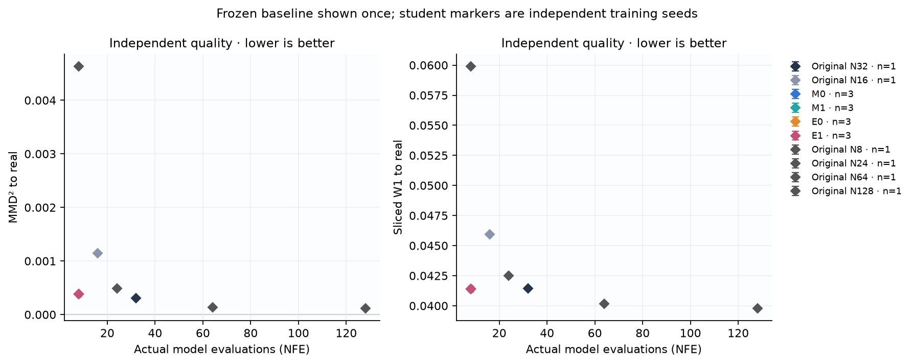
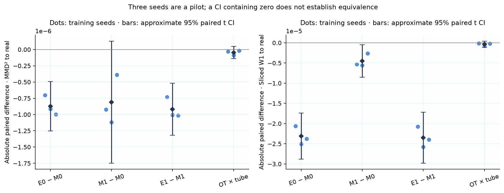
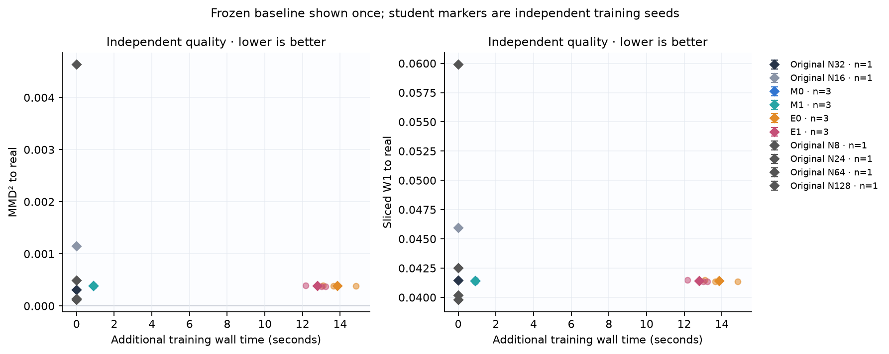
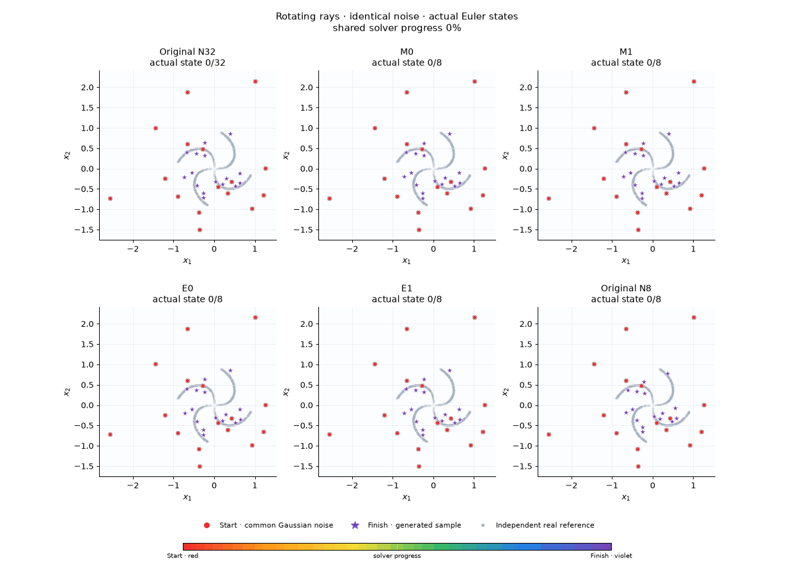
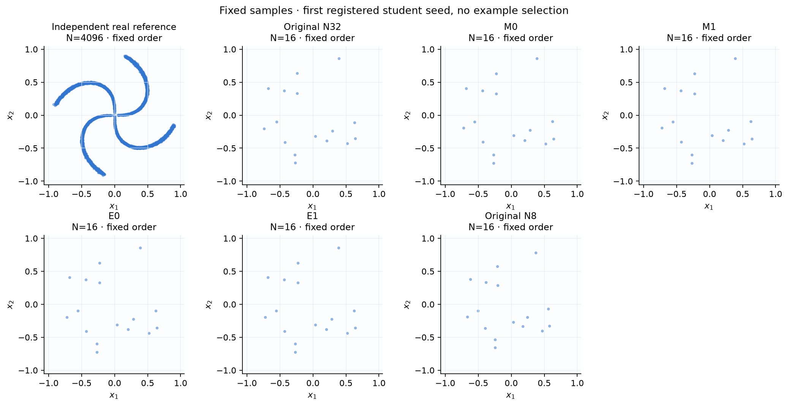
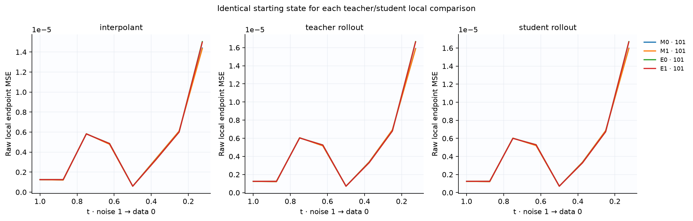
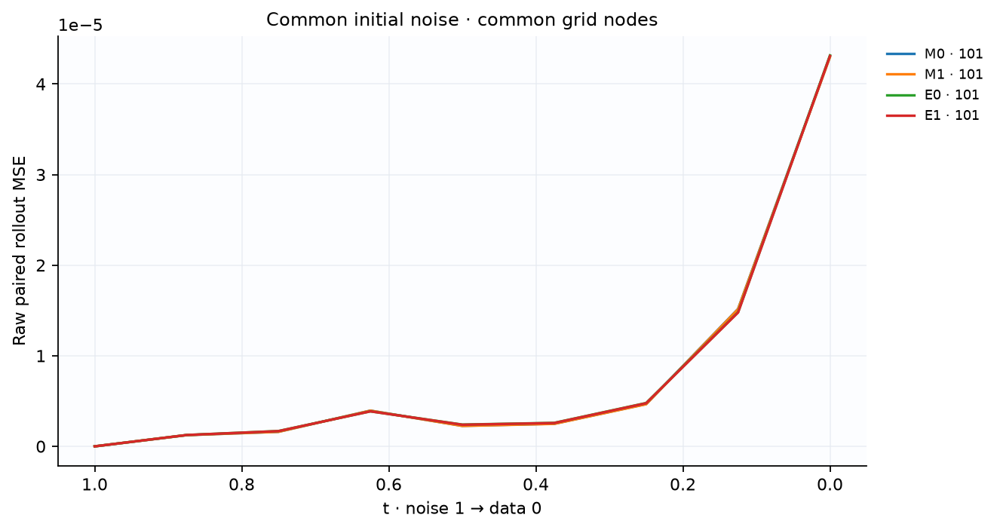
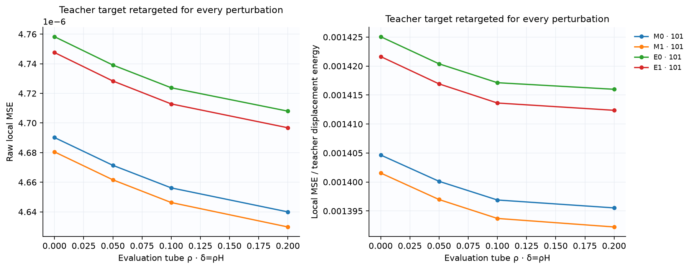
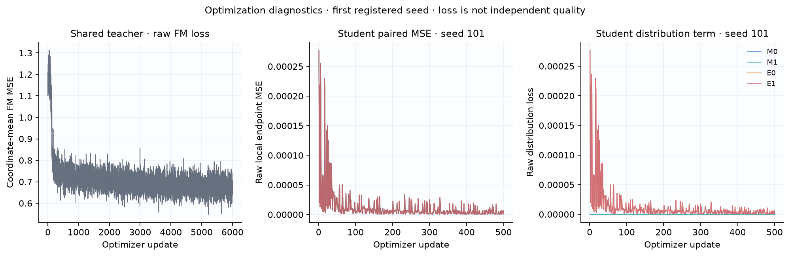

# Контролируемый пилот на вращающихся лучах

Это независимая реализация протокола [P] из REPLICATION_SPEC.md. Числа ниже получены на вращающихся лучах; это не результаты MNIST и не буквальное воспроизведение диплома.

**Основной MNIST-контраст E0 − M0: not_tested.** Полная MNIST-серия не выполнена на CPU. Результаты этого пилота проверяют реализацию и показывают поведение на малом стенде; они не устанавливают перенос на MNIST.

Зафиксированы один общий teacher и 3 student seed: `[101, 202, 303]`. Выбор анимаций: первый зарегистрированный seed `101`, без выбора по качеству. Все методы и NFE используют общий исходный шум; real reference независима от генераций.

Protocol: `rays_stress_32_8_v1`. Teacher SHA: `5fcbe5ceee197bf2a257b1347586335d7feb8a15789ba406f918a077cf3e6930`. Noise SHA: `3e2400776365f34f754a5cb69b04c539be41b976ebb9df4f247f2be70d42ea09`.

## Качество относительно реальных данных

MMD² — несмещённая двухвыборочная оценка с фиксированным train-only RBF; отрицательные значения допустимы и сохранены. SWD здесь — среднее projected W1 существующего проекта, 1024 фиксированных независимых направления; это другая величина, чем squared SW2 training loss.

| Метод | Student seed | NFE | MMD² → real | SWD → real |
|---|---:|---:|---:|---:|
| Original N8 | frozen baseline | 8 | 0.00463536 | 0.0599121 |
| Original N16 | frozen baseline | 16 | 0.00114123 | 0.0459183 |
| Original N24 | frozen baseline | 24 | 0.000484651 | 0.0424931 |
| Original N32 | frozen baseline | 32 | 0.000305065 | 0.0414373 |
| Original N64 | frozen baseline | 64 | 0.000132119 | 0.0401516 |
| Original N128 | frozen baseline | 128 | 0.000113631 | 0.0397745 |
| M0 | 101 | 8 | 0.000379365 | 0.0413612 |
| M1 | 101 | 8 | 0.000378443 | 0.0413559 |
| E0 | 101 | 8 | 0.000378664 | 0.0413407 |
| E1 | 101 | 8 | 0.000377711 | 0.0413352 |
| M0 | 202 | 8 | 0.000379984 | 0.0413788 |
| M1 | 202 | 8 | 0.000378866 | 0.0413733 |
| E0 | 202 | 8 | 0.000379067 | 0.0413538 |
| E1 | 202 | 8 | 0.000377861 | 0.0413475 |
| M0 | 303 | 8 | 0.000396846 | 0.0414895 |
| M1 | 303 | 8 | 0.000396458 | 0.0414868 |
| E0 | 303 | 8 | 0.000395847 | 0.0414657 |
| E1 | 303 | 8 | 0.000395442 | 0.0414629 |

## Парные различия между независимыми обучениями

Отрицательное различие благоприятно для первого метода. Интервал — приближённый paired t CI по seed; три seed являются пилотом. Интервал, включающий ноль, не доказывает эквивалентность. Относительные проценты от MMD не вычисляются.

| Контраст | Метрика | Парные значения по seed | Mean | Sample std | 95% CI |
|---|---|---|---:|---:|---|
| E0_minus_M0 | mmd2_real | -7.01631e-07, -9.16484e-07, -9.9861e-07 | -8.72242e-07 | 1.53353e-07 | [-1.25319e-06, -4.91292e-07] |
| M1_minus_M0 | mmd2_real | -9.21789e-07, -1.1175e-06, -3.87662e-07 | -8.08984e-07 | 3.77771e-07 | [-1.74742e-06, 1.2945e-07] |
| E1_minus_M1 | mmd2_real | -7.32073e-07, -1.0051e-06, -1.01566e-06 | -9.17613e-07 | 1.6077e-07 | [-1.31699e-06, -5.18239e-07] |
| OT_x_tube_interaction | mmd2_real | -3.04414e-08, -8.86203e-08, -1.70528e-08 | -4.53715e-08 | 3.80481e-08 | [-1.39888e-07, 4.91452e-08] |
| E0_minus_M0 | sliced_wasserstein | -2.05838e-05, -2.50521e-05, -2.37514e-05 | -2.31291e-05 | 2.29827e-06 | [-2.88383e-05, -1.74199e-05] |
| M1_minus_M0 | sliced_wasserstein | -5.30865e-06, -5.57222e-06, -2.63729e-06 | -4.50605e-06 | 1.62375e-06 | [-8.53967e-06, -4.72434e-07] |
| E1_minus_M1 | sliced_wasserstein | -2.07475e-05, -2.57693e-05, -2.39398e-05 | -2.34855e-05 | 2.54152e-06 | [-2.9799e-05, -1.7172e-05] |
| OT_x_tube_interaction | sliced_wasserstein | -1.63737e-07, -7.17142e-07, -1.88385e-07 | -3.56421e-07 | 3.12636e-07 | [-1.13305e-06, 4.2021e-07] |

## Fidelity относительно общего teacher

Fidelity измеряет воспроизведение teacher при общем шуме; улучшение fidelity само по себе не означает улучшение качества относительно данных. Raw MSE считается без clamp.

| Метод | Student seed | NFE | Paired endpoint MSE |
|---|---:|---:|---:|
| Original N8 | frozen | 8 | 0.0021345 |
| Original N16 | frozen | 16 | 0.000259736 |
| Original N24 | frozen | 24 | 5.04367e-05 |
| Original N32 | frozen | 32 | 0 |
| Original N64 | frozen | 64 | 6.4201e-05 |
| Original N128 | frozen | 128 | 0.000139059 |
| M0 | 101 | 8 | 4.40595e-05 |
| M1 | 101 | 8 | 4.39687e-05 |
| E0 | 101 | 8 | 4.45784e-05 |
| E1 | 101 | 8 | 4.44873e-05 |
| M0 | 202 | 8 | 4.18787e-05 |
| M1 | 202 | 8 | 4.18233e-05 |
| E0 | 202 | 8 | 4.24905e-05 |
| E1 | 202 | 8 | 4.24457e-05 |
| M0 | 303 | 8 | 4.69622e-05 |
| M1 | 303 | 8 | 4.70139e-05 |
| E0 | 303 | 8 | 4.73968e-05 |
| E1 | 303 | 8 | 4.74353e-05 |

## Стоимость

Время обучения teacher является общей стоимостью. В таблице training wall time ученика — дополнительная стоимость; frozen baseline не считается отдельным повторным обучением. Timings относятся к указанному batch и этому оборудованию. NFE — число последовательных evaluations для одного примера; total model calls дополнительно учитывает разбиение всего набора на batches.

| Метод | Seed | NFE / sample | Total model calls | Training seconds | Median generation seconds |
|---|---:|---:|---:|---:|---:|
| Original N8 | frozen | 8 | 64 | 13.1921 | 0.00153617 |
| Original N16 | frozen | 16 | 128 | 13.1921 | 0.00296904 |
| Original N24 | frozen | 24 | 192 | 13.1921 | 0.00477804 |
| Original N32 | frozen | 32 | 256 | 13.1921 | 0.00599921 |
| Original N64 | frozen | 64 | 512 | 13.1921 | 0.0118397 |
| Original N128 | frozen | 128 | 1024 | 13.1921 | 0.0259863 |
| M0 | 101 | 8 | 64 | 0.91333 | 0.00164517 |
| M1 | 101 | 8 | 64 | 0.916139 | 0.00159183 |
| E0 | 101 | 8 | 64 | 13.64 | 0.00153996 |
| E1 | 101 | 8 | 64 | 13.0139 | 0.00153204 |
| M0 | 202 | 8 | 64 | 0.907861 | 0.0015015 |
| M1 | 202 | 8 | 64 | 0.893411 | 0.00151142 |
| E0 | 202 | 8 | 64 | 14.8275 | 0.00137796 |
| E1 | 202 | 8 | 64 | 13.2241 | 0.00163646 |
| M0 | 303 | 8 | 64 | 0.91049 | 0.00143292 |
| M1 | 303 | 8 | 64 | 0.901196 | 0.00179775 |
| E0 | 303 | 8 | 64 | 13.0824 | 0.00161312 |
| E1 | 303 | 8 | 64 | 12.1726 | 0.00144146 |

## Реальные траектории

Начало красное, конец фиолетовый. Кружки — общий Gaussian noise, звёзды — финальные точки. Кадры выбирают сохранённые состояния Euler; между узлами нет интерполяции. Все панели имеют одинаковые оси. Фиксированный первый seed не является выбором лучшего запуска.

## Диагностика и ограничения

Local error сравнивает teacher/student из одного и того же anchor. Рассматриваются interpolant, реальный teacher rollout и method-dependent student rollout. Для robustness teacher target пересчитывается после каждого возмущения; tube имеет δ=ρH на координату. Линейный интерполянт пары данных и шума не является индивидуальной ODE-траекторией маргинального поля.

Один teacher ограничивает выводы этим teacher. Три student seed недостаточны для универсального ранжирования. Ученики оцениваются на зарегистрированной сетке; frozen original на той же короткой сетке нужен для сравнения практической полезности. Снижение training loss, local error или совпадение с teacher не заменяет независимую оценку качества.

Основные H1–H4 для unconditional pixel MNIST остаются `not_tested`; сравнения лучей являются отдельным диагностическим пилотом. H3 (все пространства endpoint/displacement/joint) не проверяется матрицей MVP.

## Данные и воспроизведение отчёта

Таблицы автоматически построены из `evaluation/results.json`; парные различия сохранены в `paired_comparisons.csv`, отдельные строки — в `results_per_seed.csv`, происхождение кадров — в `animations_manifest.json`. Используются только сохранённые метрики и траектории; отчёт не обучает и не выбирает примеры.

Команда: `python -m recheck.cli report --runs replication/artifacts/rays_stress_32_8_v1 --output <report_dir>/REPORT.md`.

## Кривые локальной ошибки, rollout и robustness

Student rollout anchors зависят от метода. Для каждого local сравнения вход у teacher/student общий; при каждом rho target пересчитывается. Производные, если измерены, следует читать вместе с проверкой при ζ/2.

## Наблюдаемая оптимизация

Loss служит диагностикой оптимизации; вывод о качестве основан на независимых quality metrics.
