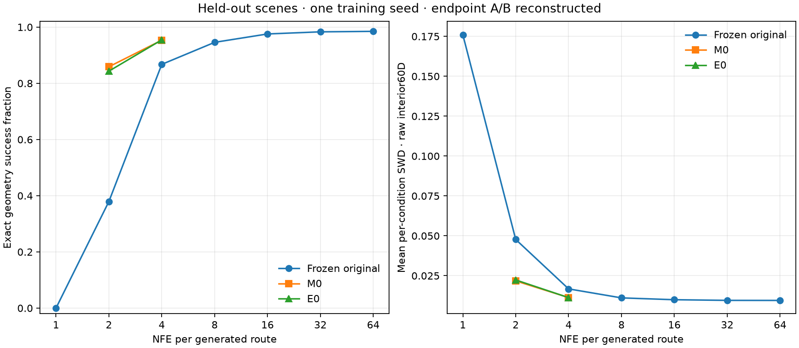
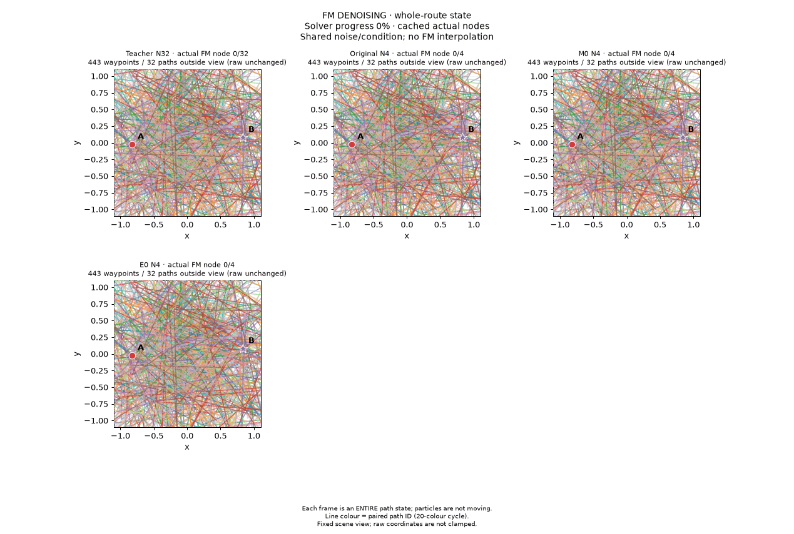
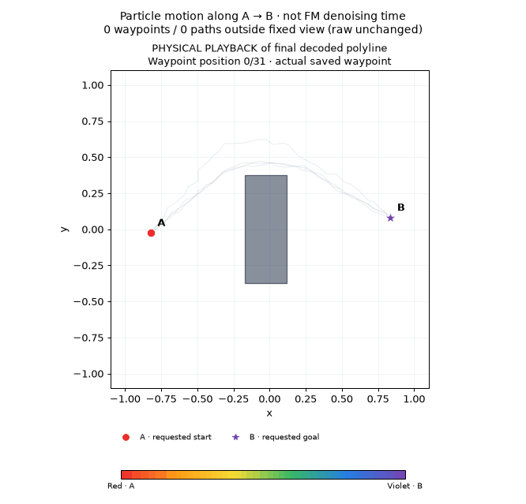

# Маршруты A → B вокруг стены: условная FM и дистилляция

На новых сценах дистилляция заметно улучшила маршруты при малом числе шагов. При **NFE 4** доля успешных путей выросла с **86,74%** у исходной модели до **95,34% M0** и **95,46% E0**. При **NFE 2** — с **37,94%** до **85,89% M0** и **84,33% E0**. Добавление OT дало всего пять дополнительных успешных путей на NFE 4 и на 64 пути меньше на NFE 2 относительно MSE. Это **один seed обучения учеников**; преимущество OT по результату не установлено.

Учитель остаётся лучше: Teacher32 проходит 98,32% путей, Teacher64 — 98,49%. Даже у Teacher64 есть 62 коллизии из 4096; ни один вариант не является безошибочным планировщиком.

## Задача и обучение

Модель получает восемь непрерывных координат: A, B, нижний и верхний угол стены. Для одного и того же условия в данных есть два обхода — сверху и снизу. **Route ID не подаётся в модель.** Состояние модели — внутренние 30 точек полного маршрута из 32 точек. Концы A/B восстанавливаются точно на каждом узле, поэтому точность концов здесь задана конструкцией, а не выучена.

Учитель — PointDenoiser MLP 128× 3, 364220 параметров, чистый conditional flow matching: 20000 обновлений, batch 256, seed 61. Обучающие данные: 128 сцен × 128 путей = 16384. Ученики используют ту же архитектуру, общий Teacher32 и по 1000 обновлений с batch 128, seed 161. **M0** минимизирует парный MSE; **E0** добавляет дебайасированный Sinkhorn-лосс по endpoint-представлению всего 60-мерного внутреннего состояния, с полным KL-членом. Поддержка OT всегда относится к одному непрерывному условию; лоссу не разрешено сопоставлять маршруты разных стен или целей. CFG не используется.

Перед обучением учеников учитель проверен только на Validation: 32 новые сцены × 128 путей, отдельные seed 10061/613001. Validation success для NFE 2/4/32/64 составил 28,93% /82,08% /97,39% /97,80%. Оба обхода найдены среди успешных маршрутов во всех 32 условиях. Эти результаты показали, что задача действительно портится при малом NFE. [Полная Validation QC](teacher_qc/metrics.json), [визуальная проверка](teacher_qc/visual_qa.json).

## Закрытая финальная оценка

Test создан после фиксации **всех четырёх** зарегистрированных учеников. Проверены завершение 1000 обновлений, фактические хеши checkpoint EMA и native-экспортов, хеши исходников/численного дополнения и полное совпадение 1000 сохранённых scene/interval/data/noise trace между M0/E0 внутри каждого NFE. Модели указаны явно в окончательной регистрации; старые численные попытки не выбирались по качеству. [План до Test](FINAL_EVALUATION_PLAN.md), [зафиксированный preflight и результаты](final_test/metrics.json).

Test: **32 новые сцены × 128 путей = 4096**, `seed=20061`, `split='test'`. Шум `seed=614001`: одинаковые 128 начальных состояний повторяются для каждого условия и используются всеми 11 вариантами. Успех требует отсутствия пересечений **всех отрезков**, включая промежутки между waypoint’ами, со стеной с запасом 0,035; также проверяются границы сцены. В этой выборке все концы и границы допустимы, поэтому число неуспешных путей совпадает с числом коллизий.

«Обе моды» — доля **всех 32 условий**, в которых найдены и верхний, и нижний успешные однозначные обходы. Коллидирующие маршруты не повышают покрытие. SWD — среднее по отдельным условиям расстояние до реальных Test-путей в исходном 60-мерном внутреннем пространстве, 128 фиксированных проекций. Оно характеризует распределение, а не только отдельные точки. MSE к Teacher32 описывает парное сходство с родителем и не заменяет геометрическую проверку.

| Модель | NFE | Успех | Коллизии /4096 | Обе моды | Условный SWD ↓ | MSE к Teacher32 ↓ | Средняя длина |
|---|---:|---:|---:|---:|---:|---:|---:|
| Original |1|0,00%|4096|0/32|0,176018|0,0508050|1,679|
| Original |2|37,94%|2542|32/32|0,047712|0,00694471|1,820|
| Original |4|86,74%|543|32/32|0,016741|0,00177707|1,879|
| Original |8|94,58%|222|32/32|0,011100|0,000387255|1,888|
| Original |16|97,56%|100|32/32|0,009951|0,0000629637|1,892|
| Teacher / Original |32|98,32%|69|32/32|0,009548|0|1,893|
| Original |64|98,49%|62|32/32|0,009508|0,0000185059|1,895|
| M0 |4|95,34%|191|32/32|0,011311|0,000613826|1,897|
| E0 |4|95,46%|186|32/32|0,011262|0,000630755|1,897|
| M0 |2|85,89%|578|32/32|0,021733|0,00241558|1,946|
| E0 |2|84,33%|642|32/32|0,022342|0,00248678|1,954|

Средняя длина в таблице включает коллизии: короткий путь сквозь стену не является хорошим маршрутом. Длины только успешных путей и все результаты отдельных путей сохранены в [JSON](final_test/metrics.json) и [CSV](final_test/results.csv). Все реальные Test-пути прошли геометрическую проверку.

На NFE 4 эффект E0−M0 составляет **+0,122 процентного пункта** успеха и −0,00004944 SWD; парный MSE к родителю немного выше. На NFE 2 эффект составляет **−1,563 процентного пункта**, +0,00060884 SWD и также более высокий MSE. Оба ученика улучшают исходную модель с тем же NFE, но этот прогон не подтверждает пользу OT поверх MSE. Покрытие обеих мод не означает идеального их баланса: успешные top/bottom counts для M0/E0 N4 равны 2015/1890 и 2015/1895, для M0/E0 N2 — 1799/1719 и 1780/1674.

## Реальные анимации

Везде показана **Test-сцена 0, первые 32 зафиксированных шума**; пути не отбирались по качеству. В FM-анимации кадр — состояние **целого маршрута**, а цвет линии — ID парного шума. Ученик с меньшим NFE удерживает свой последний фактический узел до следующего доступного: новые состояния между узлами не интерполируются. Счётчики точек вне фиксированного вида сохраняют видимость исходного неограниченного шума; данные не обрезаются и не исправляются.

**Teacher32, Original N4, M0 N4 и E0 N4:**

**Teacher32, Original N2, M0 N2 и E0 N2:**

В отдельной физической анимации частицы идут по **финальным сохранённым waypoint’ам** первых четырёх путей, от красного A к фиолетовому B. Это воспроизведение декодированного маршрута, а не движение частицы по FM-векторному полю. Первые четыре пути могут случайно оказаться в одной моде; обе моды оцениваются по полной выборке, без замены preview.

| MSE, NFE 2 | MSE + Sinkhorn, NFE 2 |
|---|---|
|  |  |

[M0 N4: физическое воспроизведение](final_test/m0_n4_spatial_particle.gif), [E0 N4](final_test/e0_n4_spatial_particle.gif), [Teacher32](final_test/teacher_n32_spatial_particle.gif). Статические PNG/SVG содержатся рядом; серым в mode-раскраске обозначены неуспешные или неоднозначные маршруты.

## Численный сбой и его исправление

Исходный E0 N2 остановился на реальном update 17: холодный Sinkhorn не достиг допуска 1e−10 за 2000 итераций; ошибка строк была 0,000124. При этом граф ненулевых `exp(-C/epsilon)` **оставался связным**, хотя 50,7% элементов обнулились из-за underflow. У холодной финальной итерации Hessian имел два численных нулевых направления при пороге 2,26× 10⁻¹⁶; оставшийся residual практически целиком лежал в отбрасываемом численном подпространстве.

До открытия Test зарегистрировано дополнение: физические dual offsets прогреваются epsilon-continuation с log/Newton-уточнением. **Финальные epsilon, допуск 1e−10, float64, целевая функция и градиенты self-термов сохранены**; лимит 2000 применяется к каждой ступени. Обе E0-модели заново обучены полные 1000 обновлений от того же родителя. Веса, checkpoint и истории M0-контролей сохранены побайтно; manifests дополнены provenance-полями; исходный E0 N4 остался численным контролем, а не кандидатом для выбора по Test.

На сохранённом сбойном batch ошибка строк уменьшилась до 4,31× 10⁻¹⁴, ошибка столбцов — 3,42× 10⁻¹⁶. На умеренном epsilon совпадение loss/gradient со старым решателем — 4,44× 10⁻¹⁶ /6,94× 10⁻¹⁷. Проверка фактического MPS→CPU float64-моста дала ошибку loss 7,67× 10⁻⁸ и максимальную ошибку градиента 0. [Полный численный regression report](numerics/continuation_regression_report.json), [MPS-проверка](numerics/mps_bridge_smoke.json). Поправка касается численного пути решения, а не подбора epsilon по качеству.

## Стоимость и воспроизводимость

Перед выбором устройства проведены короткие фактические прогоны: после 100 прогревочных обновлений среднее по 100 измеренным обновлениям составляло 0,01049 с на CPU и 0,01875 с на MPS. Для этой маленькой MLP выбран CPU. Во время этих проверок могли параллельно обучаться лучевые модели; результаты использованы для рабочего выбора устройства, а не как публикационный latency benchmark.

Учитель обучался 263,54 с на CPU. Зафиксированные стадии повторного обучения E0 заняли 158,21 с для NFE 4 и 233,04 с для NFE 2, включая notebook setup и загрузку контроля; это не изолированное сравнение времени M0/E0. Финальное вычисление всех 11 наборов метрик заняло 5,20 с, вся оценка вместе с рендером — 45,85 с, 4 потока CPU. Измерения разделяли компьютер с другими разрешёнными задачами; отдельный изолированный latency benchmark здесь не проводился. Сокращение 32→4/2 означает 8/16 раз меньше вызовов сети на маршрут, а не измеренное ускорение wall-clock.

Это один учитель seed 61 и один seed учеников 161, синтетические прямоугольные стены и ограниченный диапазон условий. 4096 путей не являются 4096 независимыми повторениями обучения. Доверительные интервалы по seed и подтверждающие выводы о превосходстве метода не строятся. Отдельный эксперимент с тремя seed на вращающихся лучах сохранён рядом.

Публичные [конечные пути всех 11 вариантов](final_test/final_endpoints.pt) занимают 13,10 MiB, [истории сцены 0](final_test/scene0_histories.pt) — 1,21 MiB. Каждый endpoint скопирован из среза в отдельное хранилище перед сохранением, поэтому файл не содержит скрытых полных историй. Полные истории находятся в игнорируемом `replication/artifacts/wall_navigation_conditional_v1/final_test_cache/`. В ноутбук не встроены ни веса, ни wheel. Хеши моделей, данных, шума, условий, проекций, исходников и полной процедуры проверки зафиксированы в [metrics.json](final_test/metrics.json); результаты сохранены до рендера.

## Открыть и обучить

[Notebook 14](../../../notebooks/14_wall_navigation_distillation.ipynb) · [Colab](https://colab.research.google.com/github/Vovanm88/ddpm_vibe_research/blob/research/wasserstein-tube-replication/notebooks/14_wall_navigation_distillation.ipynb) · [Выбранные native EMA и регистрация](../../demo/wall_navigation_conditional_v1). Обучение учителя и обоих учеников, teacher targets, loss и optimizer step видны в ячейках. Интерактивные графики переключают сцену, начальный шум, модель и фактический Euler-шаг.

Полный notebook выполнен с опубликованным parent и default M0/E0 × 200 updates: все 13 ячеек, 41,39 с, точный native reload, frozen parent и совпадение парных RNG; веса и outputs в notebook отсутствуют. [Smoke-отчёт](notebook14_native_smoke.json). Полная проверка проекта: [666 passed, 3 skipped](../pytest_report.json).
